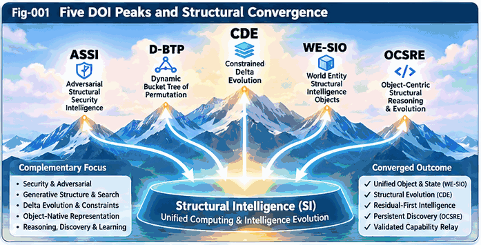

# Figure Index — Beyond Static Computation and Structural Evolution

**Version:** 1.0.0  
**Date:** 2026-11-08  
**Status:** Research figure plan and editorial insertion guide; conceptual illustrations are not empirical evidence.

## 1. Purpose and editorial conventions

This index provides the canonical identifiers, intended filenames, explanatory captions, and manuscript placement for ten figures accompanying the research program *Beyond Static Computation and Structural Evolution*. The figures connect five source research programs—ASSI, D-BTP, CDE, WE-SIO, and OCSRE—to six synthesis papers, three experimental laboratory designs, and an evidence-governed validation roadmap.

**Important asset distinction.** The canonical filenames below are the *publication naming convention*. Image-generation outputs currently stored under descriptive, automatically assigned filenames must be visually reviewed and renamed or copied to the corresponding canonical filenames before the Markdown image references are activated. The existence of a generated illustration does not establish that a correctly named, editorially approved figure file exists. Text inside AI-generated images must be checked for spelling, arrow direction, conceptual consistency, and legibility.

### Figure standards

- Preserve a single identifier (`Fig-001`–`Fig-010`) across the caption, filename, figure index, and manuscript reference.
- Use explanatory captions that state the *proposed relationship* rather than implying experimental confirmation.
- Label hypotheses, proposed contracts, and unvalidated capability flows as such; do not use visual polish as a substitute for evidence.
- Use legible text at GitHub width, accessible contrast, meaningful alt text, and a consistent visual language.
- Where a figure depicts a loop, distinguish observation, candidate generation, validation, promotion, and feedback.
- Keep evidence provenance and applicability boundaries visible in figures concerning relay and validation.
- Store final assets in `figures/` and use relative paths from the relevant Markdown document.

## 2. Canonical figure inventory

| ID | Canonical filename | Primary document | Principal research question |
|---|---|---|---|
| Fig-001 | `Fig-001-Five-DOI-Peaks-and-Structural-Convergence.png` | `docs/001-Five-DOI-Peaks.md` | How do five distinct research lines converge without losing their boundaries? |
| Fig-002 | `Fig-002-WE-SIO-Object-Native-Intelligence-Architecture.png` | `docs/002-WE-SIO-Object-Native-Intelligence.md` | What does an extensible, persistent world-entity representation contribute? |
| Fig-003 | `Fig-003-Structural-Evolution-Computing-Architecture.png` | `docs/003-Structural-Evolution-Computing.md` | How do state, constrained deltas, memory, evaluation, and generators co-evolve? |
| Fig-004 | `Fig-004-Residual-First-In-Situ-Intelligence-Loop.png` | `docs/004-Residual-First-In-Situ-Intelligence.md` | How can unresolved differences remain actionable computational objects? |
| Fig-005 | `Fig-005-Persistent-Structural-Discovery-and-SEFL.png` | `docs/005-Persistent-Structural-Discovery.md` | How can resource-bounded persistent discovery identify and test opportunities? |
| Fig-006 | `Fig-006-Intelligence-Spillover-and-Collective-Relay.png` | `docs/006-Intelligence-Spillover-and-Relay.md` | What must accompany a capability for evidence-aware transfer? |
| Fig-007 | `Fig-007-SQL-Discovery-Laboratory.png` | `experiments/EXP-001-SQL-Discovery-Lab.md` | Can object-aligned SQL/CDC observations improve validated structural discovery? |
| Fig-008 | `Fig-008-Dynamic-Scheduling-Evolution-Laboratory.png` | `experiments/EXP-002-Dynamic-Scheduling-Lab.md` | Can constrained structural evolution improve dynamic repair and transfer? |
| Fig-009 | `Fig-009-Stock-Pattern-Discovery-Laboratory.png` | `experiments/EXP-003-Stock-Pattern-Lab.md` | Can persistent discovery survive nonstationarity and strict out-of-sample testing? |
| Fig-010 | `Fig-010-Structural-Claims-Validation-and-Relay-Roadmap.png` | `research/VALIDATION-ROADMAP.md` | How do claims become reproducible evidence and safely relayed capabilities? |

## 3. Detailed captions and insertion guidance

### Fig-001 — Five DOI Peaks and Structural Convergence

**Canonical asset:** `figures/Fig-001-Five-DOI-Peaks-and-Structural-Convergence.png`  
**Primary placement:** `docs/001-Five-DOI-Peaks.md`, immediately after the introduction of the five source programs and before the synthesis of their shared contributions.

**Publication caption:** *Five complementary research programs—Adversarial Structural Security Intelligence (ASSI), Dynamic Bucket Tree of Permutation (D-BTP), Constrained Delta Evolution (CDE), World Entity and Structural Intelligence Operations (WE-SIO), and Object-Centric Structural Reasoning and Evolution (OCSRE)—contribute distinct structures to a proposed research synthesis. The convergence represents an architectural hypothesis, not an experimentally established unification.*

**Visual checks:** Five names appear once each; no hierarchy of proven superiority is implied; source-program distinctions remain visible.

**Suggested alt text:** Five named research peaks converge into a proposed structural intelligence architecture.

### Fig-002 — WE-SIO Object-Native Intelligence Architecture

**Canonical asset:** `figures/Fig-002-WE-SIO-Object-Native-Intelligence-Architecture.png`  
**Primary placement:** `docs/002-WE-SIO-Object-Native-Intelligence.md`, after the WE Core Frame and plugin model are introduced, before the SQL alignment discussion.

**Publication caption:** *A proposed WE-SIO object-native architecture preserves persistent identity, state, relations, history, residuals, and capabilities through a core frame extended by plugins. SQL table, row, column, and change-data-capture structures may be aligned at structural, semantic, and operational levels; alignment does not imply replacing conventional databases.*

**Visual checks:** Core and plugins are distinguishable; persistence is explicit; SQL alignment is bidirectional where appropriate; do not imply all properties must be physically stored in one object.

**Suggested alt text:** WE core frame linked to identity, state, relations, history, residual, capabilities, plugins, and SQL alignment.

### Fig-003 — Structural Evolution Computing Architecture

**Canonical asset:** `figures/Fig-003-Structural-Evolution-Computing-Architecture.png`  
**Primary placement:** `docs/003-Structural-Evolution-Computing.md`, after the state-container and constrained-delta definitions, before the comparison with existing optimization approaches.

**Publication caption:** *Proposed structural evolution computing cycle: a state container and constraints delimit candidate delta generation; evaluation, path memory, and validation inform state updates and possible generator improvement. Composable deltas and explicit loop-back rules help control evolution. The architecture must be compared with established dynamic optimization, incremental computation, and adaptive search baselines.*

**Visual checks:** Evaluation precedes acceptance; constraints gate state transitions; rejected candidates are not depicted as applied changes; path memory and generator improvement are separate functions.

**Suggested alt text:** Constraint-aware cycle connecting state, delta generation, evaluation, path memory, and generator evolution.

### Fig-004 — Residual-First In-Situ Intelligence Loop

**Canonical asset:** `figures/Fig-004-Residual-First-In-Situ-Intelligence-Loop.png`  
**Primary placement:** `docs/004-Residual-First-In-Situ-Intelligence.md`, following the definition and lifecycle of a residual.

**Publication caption:** *Residual-first in-situ intelligence treats unresolved prediction differences, constraint conflicts, explanation gaps, and opportunity signals as persistent, traceable objects. Residual production, retention, localization, inference, learning, structural correction, and feedback form a proposed loop; persistence enables later investigation but does not itself guarantee discovery or improvement.*

**Visual checks:** Residual identity, source, history, validation status, and next action are represented; correction may generate new residuals; no implication that all residuals are errors or valuable opportunities.

**Suggested alt text:** Persistent residual record at the center of a loop from detection through learning and correction.

### Fig-005 — Persistent Structural Discovery and SEFL

**Canonical asset:** `figures/Fig-005-Persistent-Structural-Discovery-and-SEFL.png`  
**Primary placement:** `docs/005-Persistent-Structural-Discovery.md`, following the persistent discovery-loop overview and before the SEFL experimental pools.

**Publication caption:** *The proposed Structural Emergence Fishing Laboratory (SEFL) uses adaptive observation, opportunity localization, CCC, Two-Way CCC, pattern triggering, sandbox trials, and independent validation in a persistent discovery loop. A resource-aware control policy determines what to observe and investigate; observed associations must not be conflated with causal explanations or validated capabilities.*

**Visual checks:** Seven stages are legible; sandbox precedes validation; feedback to observation and resource allocation is visible; CCC and Two-Way CCC are not portrayed as automatic causal proof.

**Suggested alt text:** Resource-bounded discovery loop from observation to CCC, triggering, sandbox testing, and validation.

### Fig-006 — Intelligence Spillover and Collective Relay

**Canonical asset:** `figures/Fig-006-Intelligence-Spillover-and-Collective-Relay.png`  
**Primary placement:** `docs/006-Intelligence-Spillover-and-Relay.md`, after the capability relay package and transfer-boundary discussion.

**Publication caption:** *A local discovery may become a relayable capability only after its evidence, interfaces, applicability limits, provenance, known failures, and unresolved questions are packaged. Receiving domains must perform their own conformance and applicability checks. Collective learning includes successful transfers, failed transfers, and explicit leftover research questions.*

**Visual checks:** Validation is not bypassed; receiving domains have independent checks; the relay package includes limits and failures, not just an output artifact.

**Suggested alt text:** Evidence-backed capability package transferred from a source domain to multiple receiving domains with feedback.

### Fig-007 — SQL Discovery Laboratory

**Canonical asset:** `figures/Fig-007-SQL-Discovery-Laboratory.png`  
**Primary placement:** `experiments/EXP-001-SQL-Discovery-Lab.md`, after the data sources and object-mapping specification, before baseline comparisons.

**Publication caption:** *Proposed SQL discovery laboratory: database snapshots and change-data-capture events are aligned to persistent WE-SIO objects; residual registration and candidate relationship discovery feed sandbox tests and independent validation. Baseline comparisons distinguish gains from object persistence, residual retention, discovery policy, and other components.*

**Visual checks:** SQL/CDC data are not silently treated as ground truth for semantics; provenance and temporal ordering are explicit; validation outcomes are separable from candidate counts.

**Suggested alt text:** SQL and CDC pipeline mapped into objects, residuals, candidate relationships, sandbox validation, and evidence.

### Fig-008 — Dynamic Scheduling Evolution Laboratory

**Canonical asset:** `figures/Fig-008-Dynamic-Scheduling-Evolution-Laboratory.png`  
**Primary placement:** `experiments/EXP-002-Dynamic-Scheduling-Lab.md`, after the objective and hard constraints, before the experimental groups.

**Publication caption:** *Dynamic school transportation serves as a constrained evolution testbed. Changes in students, stops, vehicles, or travel conditions generate residuals and candidate schedule deltas; safety, capacity, timing, and service constraints gate repairs. CDE/OCSRE proposals are compared against reoptimization, rolling-horizon repair, and adaptive search under matched budgets.*

**Visual checks:** Student safety and feasibility are hard gates; vehicle-count reduction is not shown as the sole objective; candidate repairs remain provisional until checked.

**Suggested alt text:** Dynamic bus routing map connected to constraint checks, candidate schedule deltas, and adaptive repair evaluation.

### Fig-009 — Stock Pattern Discovery Laboratory

**Canonical asset:** `figures/Fig-009-Stock-Pattern-Discovery-Laboratory.png`  
**Primary placement:** `experiments/EXP-003-Stock-Pattern-Lab.md`, after the data and temporal-integrity protocol, before the benchmark and evaluation sections.

**Publication caption:** *Nonstationary market data provide a stringent test of persistent structural discovery. Candidate patterns generated from market observations and residuals undergo time-ordered, leakage-controlled, multiple-testing-aware out-of-sample evaluation, followed by transaction-cost, liquidity, and risk analysis. Statistical patterns are not equivalent to tradable comparative advantage.*

**Visual checks:** Clear separation of training, validation, and untouched test periods; transaction costs and risk appear before any utility claim; no visual assertion of predictable profits.

**Suggested alt text:** Market time series and residual signals flowing through candidate discovery, walk-forward testing, and cost-adjusted evaluation.

### Fig-010 — Structural Claims, Validation, and Relay Roadmap

**Canonical asset:** `figures/Fig-010-Structural-Claims-Validation-and-Relay-Roadmap.png`  
**Primary placement:** `research/VALIDATION-ROADMAP.md`, after the program phases or phase-gate overview.

**Publication caption:** *Evidence governance links structural claims to falsifiable hypotheses, specifications, conformance tests, controlled experiments, reproducible evidence, and conditional capability promotion. Unverified, failed, or contradictory results return to the research registry instead of being silently promoted to validated capability. Relay packages preserve provenance, scope, and residual questions.*

**Visual checks:** Explicit failed/uncertain branch; phase gates distinguish proposed, conformant, tested, and validated; reproducibility and relay boundaries are visible.

**Suggested alt text:** Validation pipeline from research claims through hypotheses, experiments, evidence, review, and conditional relay.

## 4. Markdown insertion snippets

From a file inside `docs/`, `experiments/`, or `research/`, use `../figures/`:

```markdown


*Figure 1. Five DOI peaks and structural convergence. Conceptual architecture; not a validation result.*
```

From root-level `README.md` or `START-HERE.md`, use `figures/`:

```markdown

```

**Insertion rule:** Change the filename and caption to match each figure. Do not insert a broken link before the asset has been reviewed and placed at the canonical path.

## 5. Concept-to-figure cross-index

| Concept | Primary figure(s) | Supporting figure(s) |
|---|---|---|
| Five-DOI synthesis | 001 | 003, 006 |
| WE-SIO / object-native computing | 002 | 007, 008, 009 |
| SQL structure/semantics/operations alignment | 002, 007 | 004 |
| State container, constrained delta, path memory | 003 | 008 |
| Residual identity, persistence, localization | 004 | 007, 008, 009 |
| CCC, Two-Way CCC, pattern triggering | 005 | 007, 009 |
| SEFL / persistent resource-aware discovery | 005 | 007, 008, 009 |
| Generator improvement and structural evolution | 003, 005 | 008 |
| Evidence-bound capability relay | 006, 010 | 007, 008, 009 |
| Validation, negative results, reproducibility | 010 | 007, 008, 009 |
| Cross-domain spillover | 006 | 001, 010 |

## 6. Specification and research traceability

| Figure(s) | Specification or research artifact | Validation focus |
|---|---|---|
| 002, 004 | `specifications/SPEC-001-Object-Residual-Delta-Interfaces.md` | Identity, persistence, delta contracts, provenance |
| 003, 005 | `specifications/SPEC-002-Persistent-Discovery-Loop.md` | Observation, generation, sandbox, feedback, resource control |
| 006, 010 | `specifications/SPEC-003-Validation-and-Relay-Contracts.md` | Evidence thresholds, receiving-domain checks, promotion rules |
| 001–006 | `research/STRUCTURAL-CLAIMS-REGISTRY.md` | Claim ownership, scope, status, supporting and conflicting evidence |
| 003–010 | `research/TESTABLE-HYPOTHESES.md` | Falsifiable hypotheses TH-001–TH-018 |
| 007–010 | `research/VALIDATION-ROADMAP.md` | Experimental baselines, phase gates, reproducibility |
| 001–010 | `research/RESEARCH-DIVERGENCES.md` | Alternative explanations, conceptual boundaries |
| 001–010 | `research/OPEN-QUESTIONS.md` | Open problems and explicit residuals |

These references describe intended traceability, not completed empirical verification.

## 7. Editorial acceptance checklist

For each of Fig-001 through Fig-010:

- [ ] Asset exists under its exact canonical filename in `figures/`.
- [ ] Visual content matches the corresponding caption and primary manuscript.
- [ ] Every label, abbreviation, and arrow has been inspected at normal reading size.
- [ ] No unvalidated causal, performance, or financial claim is depicted as established fact.
- [ ] Paths resolve from the Markdown file in which the image appears.
- [ ] Alt text and numbered caption are included.
- [ ] Source-program names and terminology match `GLOSSARY.md`.
- [ ] Figure number appears consistently in the manuscript and this index.
- [ ] The image is legible on mobile and in GitHub's default content width.
- [ ] Any visual ambiguity is recorded as an editorial leftover rather than silently ignored.

## 8. Optional repository overview illustration

A separate three-laboratory overview illustration may be used in `README.md` under a non-numbered filename such as `figures/Overview-Three-Experimental-Laboratories.png`. It is **not** part of the canonical ten-figure sequence and should not replace the domain-specific Fig-007, Fig-008, or Fig-009.

## 9. Related source research programs

- [ASSI — Adversarial Structural Security Intelligence](https://github.com/sizhet/Adversarial-Structural-Security-Intelligence)
- [D-BTP — Dynamic Bucket Tree of Permutation](https://github.com/sizhet/Dynamic-Bucket-Tree-of-Permutation-and-Directional-Structural-Evolution)
- [CDE — Constrained Delta Evolution](https://github.com/sizhet/Constrained-Delta-Evolution)
- [WE-SIO — World Entity and Structural Intelligence Operations](https://github.com/sizhet/World-Entity-and-Structural-Intelligence-Operations)
- [OCSRE — Object-Centric Structural Reasoning and Evolution](https://github.com/sizhet/Object-Centric-Structural-Reasoning-and-Evolution)

## 10. Maintenance and release note

Update this index whenever a figure is revised, renamed, replaced, or relocated. For a DOI release, freeze the canonical asset set and ensure captions reflect the released version's actual claims and evidence status. Later empirical results should be documented as new evidence with traceable version history; they must not be retroactively inferred from conceptual illustrations.

**Guiding principle:** A figure should make a structural hypothesis easier to inspect, challenge, implement, and validate—not merely easier to admire.
