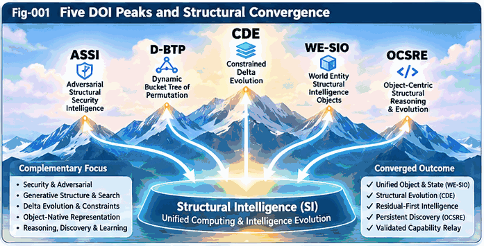

# Beyond Static Computation: Object-Centric Structural Evolution and Persistent Intelligence

**An integrative Structural Intelligence (SI) research program connecting five DOI research lines, six conceptual papers, three proposed interface specifications, and three falsifiable experimental laboratories.**

> **Research status — November 2026:** This repository is a specification-first research synthesis and experimental agenda. Its architectures, hypotheses, and laboratory protocols are **proposals**, not evidence of implemented systems, measured performance gains, autonomous intelligence emergence, or successful financial strategies.

## 1. Overview

Computational systems often separate the representation of entities, the algorithms that operate on them, the exceptions left behind by those algorithms, and the knowledge accumulated from successive attempts. This research program investigates whether more persistent structural interfaces can make those elements easier to locate, reason about, validate, evolve, and relay.

The proposed integration brings together five complementary research directions:

| Source research line | Contribution to the synthesis |
| --- | --- |
| **ASSI — Adversarial Structural Security Intelligence** | Changing identities, trust boundaries, evidence, authority, and adversarial dependencies |
| **D-BTP — Dynamic Bucket Tree of Permutation** | Directional candidate generation, branching, path-sensitive structural search, and hypothesis evolution |
| **CDE — Constrained Delta Evolution** | State containers, constrained deltas, path memory, loop-back control, and evolving generation policies |
| **WE-SIO — World Entity and Structural Intelligence Operations** | Persistent object-native representation, relations, histories, residuals, and extensible operations |
| **OCSRE — Object-Centric Structural Reasoning and Evolution** | In-situ reasoning, differential computation, learning, constrained evolution, and capability spillover |

The goal is **not** to declare a replacement for relational databases, optimization, dynamic programming, online learning, or streaming systems. Rather, it is to formulate interoperable structural contracts and test whether they offer measurable advantages over strong conventional and adaptive baselines.

## 2. Research thesis

The central research question is:

> Can persistent objects, explicit residuals, constrained deltas, selective observation, and evidence-governed relay jointly improve a system's ability to discover, validate, and reuse useful structure under changing conditions?

The program explores six linked propositions:

1. **Object-native structural context.** Stable identity, state, relations, history, and capabilities can reduce repeated context reconstruction and improve interoperability when represented with explicit contracts.
2. **Constrained structural evolution.** State changes can be modeled as auditable deltas with feasibility checks, path memory, candidate generation, evaluation, and controlled adaptation of the generators themselves.
3. **Residual-first, in-situ intelligence.** Unresolved differences—prediction errors, constraint conflicts, semantic gaps, unexplained observations, and unmet capabilities—can remain addressable objects rather than disappearing at computational boundaries.
4. **Persistent structural discovery.** Selective, resource-aware observation can repeatedly localize opportunities, generate hypotheses, test patterns, and update discovery policies.
5. **Intelligence spillover.** Validated methods and capabilities may transfer between tasks and domains when accompanied by contracts, provenance, evidence, applicability limits, and failure experience.
6. **Collective learning and relay.** Sharing reproducible results, negative findings, and unresolved questions can enable cumulative structural research without forcing premature agreement.

Each proposition is a **research claim to investigate**, not a demonstrated universal result.

---



*Five complementary research programs—Adversarial Structural Security Intelligence (ASSI), Dynamic Bucket Tree of Permutation (D-BTP), Constrained Delta Evolution (CDE), World Entity and Structural Intelligence Operations (WE-SIO), and Object-Centric Structural Reasoning and Evolution (OCSRE)—contribute distinct structures to a proposed research synthesis. The convergence represents an architectural hypothesis, not an experimentally established unification.*

---

## 3. Architectural picture

```text
Five source research lines
ASSI   D-BTP   CDE   WE-SIO   OCSRE
                 |
                 v
      Object-native structural context
    Object / Identity / State / Relations
       History / Residual / Capability
                 |
                 v
        Persistent discovery loop
Observe -> Localize -> Hypothesize -> Test
   ^                             |
   |                             v
   +-- Learn / Evolve <- Validate / Reject
                 |
                 v
       Constrained delta evolution
    State + Constraints + Path Memory
    Candidate Generation + Evaluation
                 |
                 v
       Evidence-governed capability relay
   Contracts + Results + Limits + Failures
                 |
                 v
       Independent reuse and feedback
```

**WE-SIO** provides a proposed object-centered carrier, not an obligatory replacement for SQL or existing systems. **CDE/OCSRE** describe complementary forms of constrained state and computational evolution. **Residual-first** and **persistent discovery** organize the unfinished work and emerging opportunities across those structures. **Relay** governs how independently validated capabilities, limitations, and research leftovers travel between contexts.

## 4. Reading guide: six core papers

Start with [001 — Five DOI Peaks](docs/001-Five-DOI-Peaks.md) for the overall synthesis, then follow the architectural sequence below.

| Paper | Primary question |
| --- | --- |
| [001 — Five DOI Peaks](docs/001-Five-DOI-Peaks.md) | What becomes visible when the five research lines are examined together? |
| [002 — WE-SIO Object-Native Intelligence](docs/002-WE-SIO-Object-Native-Intelligence.md) | What persistent object representation and SQL-aligned interfaces are useful? |
| [003 — Structural Evolution Computing](docs/003-Structural-Evolution-Computing.md) | How can state, deltas, constraints, search, and generator evolution be organized? |
| [004 — Residual-First In-Situ Intelligence](docs/004-Residual-First-In-Situ-Intelligence.md) | How can unresolved differences become persistent, actionable computation objects? |
| [005 — Persistent Structural Discovery](docs/005-Persistent-Structural-Discovery.md) | How can resource-bounded observation, CCC, Two-Way CCC, triggering, and validation form a discovery loop? |
| [006 — Intelligence Spillover and Relay](docs/006-Intelligence-Spillover-and-Relay.md) | What evidence and contracts are required to transfer useful capabilities responsibly? |

## 5. Proposed interface specifications

The following specifications define **proposed** contracts. Normative terms such as MUST and SHOULD describe expected behavior of a *future conforming implementation*; they do not imply one already exists.

- [SPEC-001 — Object, Residual, and Delta Interfaces](specifications/SPEC-001-Object-Residual-Delta-Interfaces.md): identifiers, provenance, state versioning, typed residuals, constrained deltas, and replay semantics.
- [SPEC-002 — Persistent Discovery Loop](specifications/SPEC-002-Persistent-Discovery-Loop.md): observation, opportunity localization, candidate generation, sandboxing, evidence, feedback, and resource control.
- [SPEC-003 — Validation and Relay Contracts](specifications/SPEC-003-Validation-and-Relay-Contracts.md): conformance, independent validation, evidence packaging, scope limitations, permission boundaries, and reuse.

**Design rule:** specifications and conformance expectations precede any claim of runtime capability.

## 6. Three experimental laboratories

These are **experimental protocols**, not reports of completed trials.

| Laboratory | Test environment | Principal discriminating question |
| --- | --- | --- |
| [EXP-001 — SQL Discovery Lab](experiments/EXP-001-SQL-Discovery-Lab.md) | SQL schemas, rows, relations, and change-data-capture streams | Does object-aligned, residual-aware persistent discovery improve validated structural findings at comparable cost? |
| [EXP-002 — Dynamic Scheduling Lab](experiments/EXP-002-Dynamic-Scheduling-Lab.md) | Dynamic school transportation with capacity, safety, time-window, and service constraints | Does constrained delta and generator evolution outperform strong repair and rolling-horizon baselines without compromising feasibility? |
| [EXP-003 — Stock Pattern Lab](experiments/EXP-003-Stock-Pattern-Lab.md) | Nonstationary market time series | Do discoveries survive leakage-free out-of-sample tests, multiple-testing corrections, costs, risk, and regime shifts? |

The experiments are deliberately heterogeneous. A result in one domain must **not** be generalized to the others without independent validation. Financial-market research is exploratory and is **not investment advice**.

## 7. Evidence, falsifiability, and governance

The research program distinguishes five evidence states:

`Proposed -> Implemented -> Conformance-tested -> Independently validated -> Relay-eligible`

A claim may remain *inconclusive*, be *rejected*, or be *restricted to a narrower applicability boundary*. Rejected hypotheses and failed transfers remain valuable research outputs.

Key safeguards include:

- **Strong baselines:** compare against established database, streaming, optimization, search, and adaptive-learning approaches under comparable compute and engineering budgets.
- **Ablation and attribution:** isolate the value of persistent objects, residual memory, delta governance, discovery policies, and relay rather than attributing all gains to the integrated stack.
- **Temporal and causal discipline:** prevent future-data leakage; treat bidirectional conditional evidence as a testing aid, not proof of causality.
- **Feasibility and security:** enforce hard constraints, permissions, provenance, and adversarial-contamination checks before deployment or relay.
- **Full cost accounting:** measure data preparation, storage, latency, compute, monitoring, validation, human oversight, and transfer costs.
- **Explicit leftover:** retain unresolved observations, negative results, failed candidates, boundary conditions, and open questions for subsequent research.

See [Open Questions](research/OPEN-QUESTIONS.md), [Testable Hypotheses](research/TESTABLE-HYPOTHESES.md), and [Validation Roadmap](research/VALIDATION-ROADMAP.md).

## 8. Research artifacts and navigation

```text
.
├── README.md
├── START-HERE.md
├── CONTENTS.md
├── docs/
│   ├── 001-Five-DOI-Peaks.md
│   ├── 002-WE-SIO-Object-Native-Intelligence.md
│   ├── 003-Structural-Evolution-Computing.md
│   ├── 004-Residual-First-In-Situ-Intelligence.md
│   ├── 005-Persistent-Structural-Discovery.md
│   └── 006-Intelligence-Spillover-and-Relay.md
├── specifications/
│   ├── SPEC-001-Object-Residual-Delta-Interfaces.md
│   ├── SPEC-002-Persistent-Discovery-Loop.md
│   └── SPEC-003-Validation-and-Relay-Contracts.md
├── research/
│   ├── STRUCTURAL-CLAIMS-REGISTRY.md
│   ├── RESEARCH-DIVERGENCES.md
│   ├── OPEN-QUESTIONS.md
│   ├── TESTABLE-HYPOTHESES.md
│   └── VALIDATION-ROADMAP.md
├── experiments/
│   ├── EXP-001-SQL-Discovery-Lab.md
│   ├── EXP-002-Dynamic-Scheduling-Lab.md
│   └── EXP-003-Stock-Pattern-Lab.md
├── figures/
│   └── Fig-001-...png through Fig-010-...png
├── GLOSSARY.md
├── FIGURE-INDEX.md
├── FUTURE-DIRECTIONS.md
├── CHANGELOG.md
├── CITATION.cff
├── .zenodo.json
└── LICENSE
```

**Repository assembly note:** This is the *target* GitHub layout. Files listed here may be drafted or awaiting placement, figure naming, or release preparation. Do not interpret the tree as a claim that every linked file is already published. Figure references below use the agreed final filenames.

## 9. Figure plan

| Figure | Topic | Intended paper |
| --- | --- | --- |
| `Fig-001-Five-DOI-Peaks-and-Structural-Convergence.png` | Five-source synthesis | 001 |
| `Fig-002-WE-SIO-Object-Native-Intelligence-Architecture.png` | WE core, plugins, SQL alignment | 002 |
| `Fig-003-Structural-Evolution-Computing-Architecture.png` | Constrained delta and evolving search | 003 |
| `Fig-004-Residual-First-In-Situ-Intelligence-Loop.png` | Persistent residual lifecycle | 004 |
| `Fig-005-Persistent-Structural-Discovery-and-SEFL.png` | Selective discovery loop | 005 |
| `Fig-006-Intelligence-Spillover-and-Collective-Relay.png` | Evidence-governed transfer | 006 |
| `Fig-007-SQL-Discovery-Laboratory.png` | SQL/CDC experiment | EXP-001 |
| `Fig-008-Dynamic-Scheduling-Evolution-Laboratory.png` | Dynamic scheduling experiment | EXP-002 |
| `Fig-009-Stock-Pattern-Discovery-Laboratory.png` | Market-pattern experiment | EXP-003 |
| `Fig-010-Structural-Claims-Validation-and-Relay-Roadmap.png` | Claims-to-evidence research governance | Validation roadmap |

The diagrams illustrate **proposed architectures and research protocols**, not measured system results.

## 10. Relationship to earlier Structural Intelligence research

This synthesis builds on, and is intended to remain interoperable with, earlier Structural Intelligence work on scoring and control planes, SIF localization, residual-driven growth, CCC and Two-Way CCC triggers, structural recursive self-improvement, UIERU-style relay, autonomous questioning, and collective learning. In particular, CDE is proposed as an additional important **Localization / addressing method within SIF**, while WE-SIO and OCSRE expand the structural carrier and computational lifecycle. These relationships are research integration hypotheses; they do not imply that every prior repository adopts the interfaces specified here.

## 11. Source repositories

The five research programs are maintained separately; this repository is a **cross-cutting synthesis**, not a replacement for their source texts:

1. [Adversarial Structural Security Intelligence (ASSI)](https://github.com/sizhet/Adversarial-Structural-Security-Intelligence)
2. [Dynamic Bucket Tree of Permutation (D-BTP)](https://github.com/sizhet/Dynamic-Bucket-Tree-of-Permutation-and-Directional-Structural-Evolution)
3. [Constrained Delta Evolution (CDE)](https://github.com/sizhet/Constrained-Delta-Evolution)
4. [World Entity and Structural Intelligence Operations (WE-SIO)](https://github.com/sizhet/World-Entity-and-Structural-Intelligence-Operations)
5. [Object-Centric Structural Reasoning and Evolution (OCSRE)](https://github.com/sizhet/Object-Centric-Structural-Reasoning-and-Evolution)

For exact terminology, claims, assumptions, and limitations, consult the corresponding source repository and its versioned release.

## 12. Contribution and reproducibility principles

Contributions are welcome in the form of conceptual criticism, counterexamples, schema and contract refinements, baseline designs, independent experiments, negative findings, and replication packages. A useful research contribution identifies its claim, assumptions, version, methodology, evidence, limits, and remaining questions. Proposed new capabilities should not be marked validated merely because a diagram, prototype, or positive anecdote exists.

This program follows the working principles **Specifications / Contracts First**, **Conformance Before Runtime Claims**, **Explicit Leftover**, and **Collective Learning Friendly**. Scientific disagreement is a research asset when recorded precisely.

## 13. Citation, license, and release status

The intended license is **Apache License 2.0**; see `LICENSE` once the repository is assembled. Citation metadata is planned in `CITATION.cff` and `.zenodo.json`. **Do not cite a DOI until a DOI has actually been assigned.** Until then, cite the repository URL, document title, author information in its published metadata, version, and access date as appropriate.

This README describes a proposed and partially drafted research release. No repository DOI, empirical superiority, or completed independent validation is asserted here.

---

## 📚 DBM-SI Series Navigation

See:\
[./docs/DBM-SI-Series-of-gitHub-Repositories/DBM-SI-Series-of-gitHub-Repositories.md](./docs/DBM-SI-Series-of-gitHub-Repositories/DBM-SI-Series-of-gitHub-Repositories.md)

---

**Closing perspective:** The most valuable output of persistent structural intelligence may be neither a single solution nor a single model, but an evidence-bearing system that remembers what remains unexplained, learns where to look next, and makes validated improvements reusable across contexts. Whether this yields a practical advantage is precisely what the proposed experiments are designed to test.
