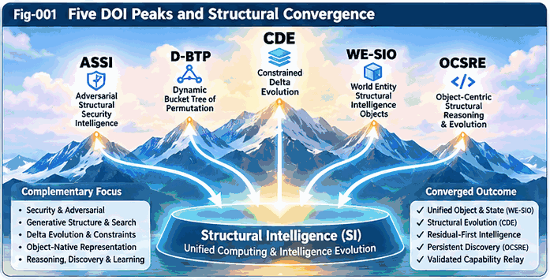

# 001 — Five DOI Peaks: From Adversarial Structural Problems to Persistent Intelligence Discovery

**Research series:** Beyond Static Computation: Object-Centric Structural Evolution and Persistent Intelligence  
**Document type:** Integrative research perspective / structural observations  
**Status:** Research synthesis and forward-looking hypotheses; not a claim of experimentally established generality  
**Version:** 1.0.0 — 2026-11-08

## Abstract

Five consecutive research programs—Adversarial Structural Security Intelligence (ASSI), Dynamic Bucket Tree of Permutation (D-BTP), Constrained Delta Evolution (CDE), World Entity and Structural Intelligence Operations (WE-SIO), and Object-Centric Structural Reasoning and Evolution (OCSRE)—suggest a coherent route from difficult, evolving real-world problems to a more general architecture for structural computation and intelligence. Their significance is not merely additive. ASSI exposes moving identities, evidence, incentives, and adversaries; D-BTP introduces directional candidate generation and path-sensitive structural search; CDE abstracts constrained state and operator evolution; WE-SIO offers an object-centered carrier for state, relations, computation, and capabilities; and OCSRE brings reasoning, differential computation, in-situ learning, and capability evolution into an integrated program.

Viewed together, the five programs motivate three research directions: (1) object-native representation and engineering spillover, including compatibility with relational data systems; (2) a shift from static localization and isolated problem solving toward constrained, evolving computational structures; and (3) treating residuals, discrepancies, and unresolved structure as first-class objects for persistent, in-situ discovery. A fourth direction follows: a governed system that continuously observes changing objects, proposes structural hypotheses, validates them, and relays reusable capabilities to collective learning. This article records the observations, conceptual connections, limitations, and testable claims arising from that vantage point. It is a map of promising terrain, not proof that the terrain has already been conquered.

**Keywords:** structural intelligence; object-centric computation; constrained delta evolution; residual-first intelligence; in-situ learning; localization; capability spillover; collective learning; persistent structural discovery.

---

## 1. Purpose and Scope

This is the opening essay in a six-part integrative series. It does **not** replace or restate the technical specifications of the five source repositories. Its task is to preserve what becomes visible *between* them: recurring structural ideas, changes in the unit of computation, emerging interfaces, engineering implications, and open questions that can be relayed to independent researchers.

The central question is:

> What new computational and intelligence architectures become conceivable when dynamic structural search, constrained evolution, world-entity representation, and object-centered reasoning are considered together?

The answer remains a research hypothesis. We distinguish:

- **Observation:** a relationship or design pattern identifiable across the research programs.
- **Architectural proposal:** a coherent arrangement of components and contracts that could be implemented.
- **Hypothesis:** an empirical claim requiring controlled testing.
- **Validated result:** a claim supported by reproducible evidence under stated conditions.

The present essay chiefly supplies the first three, not the fourth.

## 2. The Five Research Peaks

The following identifiers and repository titles follow the originating research sequence.

| No. | Program | Principal research contribution to this synthesis | Repository |
|---|---|---|---|
| 84 | **Adversarial Structural Security Intelligence (ASSI)** | Dynamic identity, evidence, trust, authority, incentives, and adversarial dependencies as a structural problem | [ASSI](https://github.com/sizhet/Adversarial-Structural-Security-Intelligence) |
| 85 | **Dynamic Bucket Tree of Permutation (D-BTP)** | Directional structural candidate generation, constrained path exploration, and hypothesis evolution | [D-BTP](https://github.com/sizhet/Dynamic-Bucket-Tree-of-Permutation-and-Directional-Structural-Evolution) |
| 86 | **Constrained Delta Evolution (CDE)** | A generalized language of state containers, admissible deltas, constrained transitions, and evolving generators | [CDE](https://github.com/sizhet/Constrained-Delta-Evolution) |
| 87 | **World Entity and Structural Intelligence Operations (WE-SIO)** | Object-centric world entities, extensible operations, metric discovery, and open-ended modeling | [WE-SIO](https://github.com/sizhet/World-Entity-and-Structural-Intelligence-Operations) |
| 88 | **Object-Centric Structural Reasoning and Evolution (OCSRE)** | Integration of deduction, differential computation, in-situ learning, constrained evolution, and capability spillover | [OCSRE](https://github.com/sizhet/Object-Centric-Structural-Reasoning-and-Evolution) |

### 2.1 ASSI: The problem refuses to stay still

ASSI starts from a demanding class of problems: the objects being analyzed are not fixed, and neither are their identities, evidence, relationships, incentives, or adversarial strategies. A security conclusion may become obsolete when an actor changes behavior, evidence arrives, or the system's trust boundary shifts. This makes static classification insufficient as the *sole* reasoning mechanism.

**Transferable observation:** structural intelligence needs explicit provenance, uncertainty, competing explanations, temporal identity, and feedback from adversarial outcomes. Security is a compelling stress case, not the only application.

### 2.2 D-BTP: Candidate structures must be generated, not merely ranked

D-BTP reframes a search problem around evolving candidate structures, directional evidence, path memory, and admissibility. The system must not simply score a fixed list of hypotheses; it must generate new ones and track what has already been attempted. Its branch and path constraints highlight a distinction between an abstract state and the history by which that state was reached.

**Transferable observation:** intelligence may require an explicit *generator of candidate structures* coupled to evaluation, rather than evaluation alone. Search history, exclusions, and path-specific constraints are computational assets.

### 2.3 CDE: Delta evolution becomes a general abstraction

CDE extends the search insight to constrained transitions over state containers. A delta can alter a candidate solution, a local representation, a generation policy, or—subject to governance—parts of the search machinery. Adaptive branching, loop-back rules, path constraints, and termination conditions become first-class design questions.

**Transferable observation:** a system can organize computation around permissible state transformations and their consequences, while preserving an auditable history of attempted changes. This also suggests a new localization role within the broader Structural Intelligence Framework (SIF): locating *where and how* productive deltas may be generated.

### 2.4 WE-SIO: World entities become computation-bearing structures

WE-SIO moves attention from algorithmic transitions to the entity on which transitions operate. An entity may bind identity, typed attributes, relations, history, metrics, operational interfaces, and extensible capabilities. Its proposed **Core Frame + Plugins** architecture separates a stable semantic and governance substrate from heterogeneous computational extensions.

**Transferable observation:** object-centric representation could reduce repeated context reconstruction and create reusable integration points for databases, event streams, graph operations, models, and specialized computation. This remains contingent on precise contracts, performance, and semantic fidelity.

### 2.5 OCSRE: Reasoning and evolution meet at the object

OCSRE connects object-centered representation to deduction, differential computation, in-situ learning, constrained state evolution, and capability spillover. It also opens a path to governance of generated code and operational dependencies through explicit object/capability relations and calling graphs.

**Transferable observation:** the object can serve as a *logical locus* for observation, reasoning, candidate generation, evaluation, and learning—even when the physical execution is distributed among external runtimes. Co-location of semantics does not require co-location of every compute cycle.

---



*Five complementary research programs—Adversarial Structural Security Intelligence (ASSI), Dynamic Bucket Tree of Permutation (D-BTP), Constrained Delta Evolution (CDE), World Entity and Structural Intelligence Operations (WE-SIO), and Object-Centric Structural Reasoning and Evolution (OCSRE)—contribute distinct structures to a proposed research synthesis. The convergence represents an architectural hypothesis, not an experimentally established unification.*

---

## 3. Why the Five Are More Than a Sequence

A useful synthesis is:

```text
ASSI       changing actors, evidence, incentives, adversarial constraints
   ↓
D-BTP      generate and evaluate evolving structural hypotheses
   ↓
CDE        generalize admissible state/delta/path evolution
   ↓
WE-SIO     represent the entities, states, relations, and capabilities
   ↓
OCSRE      integrate reasoning, computation, learning, and evolution
   ↓
PROPOSAL   persistent, governed structural discovery and relay
```

The arrows indicate a **conceptual research progression**, not a claim that each repository is technically dependent on the previous one. The more important result is a set of interfaces across previously separate concerns:

1. **Problem ↔ representation:** evolving real-world conditions can be expressed as versioned entities and relations.
2. **Representation ↔ generation:** entities expose constrained spaces of possible changes and hypotheses.
3. **Generation ↔ evaluation:** candidate deltas can be scored against evidence, constraints, and competing perspectives.
4. **Evaluation ↔ learning:** successes, failures, and unexplained discrepancies can become reusable evidence.
5. **Learning ↔ relay:** validated discoveries can be packaged as rules, plugins, metrics, or transferable capabilities.

These interfaces suggest a system whose computational structure can evolve while its observations, decisions, and provenance remain inspectable.

## 4. First New Landscape: WE-SIO as an Object-Native Engineering Substrate

### 4.1 Beyond object-centered description

Object-centric approaches can help preserve semantic context: *which entity*, *which version*, *which relationship*, *which event*, and *which capability* a calculation concerns. The stronger proposal is to attach stable computational contracts to those objects. An illustrative world entity might expose:

```text
WorldEntity {
  identity, schema_version, state_version,
  typed_attributes, relations, temporal_history,
  evidence_and_provenance, constraints,
  residual_references, capability_descriptors,
  authorization_policy, event_subscriptions
}
```

This is an **illustrative interface**, not a claim that the source repository has adopted these exact fields.

### 4.2 Core Frame + Plugins

A compact Core Frame can maintain identity, typed state, consistency, provenance, security, versioning, and capability discovery. Plugins can supply SQL access, graph traversal, statistics, optimization, time-series analysis, language-model inference, or CDE operations. The division avoids forcing all algorithms into one monolithic execution engine.

The engineering thesis is **compositionality under shared semantics**: different capabilities should be able to operate on the same object without repeatedly rebuilding identity, context, and state lineage. The corresponding risk is a universal object abstraction so broad that it becomes expensive, ambiguous, or hard to govern.

### 4.3 SQL alignment as a practical entry point

Relational databases provide a major test bed because tables, rows, columns, keys, types, constraints, transactions, and change-data capture (CDC) already exist at scale. A WE-SIO adapter could map rows or domain aggregates to entities and map columns to typed attributes. However, **column alignment is not semantic equivalence**: units, temporal validity, null semantics, joins, aggregation, access control, and transactional snapshots still matter.

Three progressively stronger levels should be distinguished:

1. **Structural alignment:** tables, columns, types, primary and foreign keys.
2. **Semantic alignment:** domain identity, units, time, constraints, and provenance.
3. **Operational alignment:** incremental updates, transactions, queries, plugin execution, and feedback.

The third level is where a database may become an input to persistent structural discovery rather than only a passive repository.

## 5. Second New Landscape: From Static Localization to Structural Evolution

SIF and related Relay architectures provide mechanisms for locating problems, capabilities, and structural correspondences. The five-program sequence raises a further question: can localization identify not just *where a capability belongs*, but *where a productive change could occur next*?

It is important not to caricature classical computing. Dynamic programming, online learning, incremental view maintenance, event-driven processing, model-predictive control, simulation, and reinforcement learning already handle changing states. The proposed novelty is **not the invention of dynamic computation**. It is the attempt to unify entity representation, candidate generation, constraints, differential updates, evaluation, and the evolution of the computation strategy itself.

A conceptual state transition can be written:

$$
S_{t+1} = T(S_t, \Delta_t; C_t), \qquad \Delta_t \in \mathcal{A}(S_t,C_t)
$$

where $S_t$ is a versioned state container, $\Delta_t$ a proposed change, $C_t$ the active constraints, and $\mathcal{A}$ the admissible delta set. A richer state may include the generator, evaluator, policy, and history:

$$
S_t = (X_t,G_t,E_t,P_t,H_t).
$$

Changes to $G_t$, $E_t$, or $P_t$ demand stronger controls than changes to ordinary problem variables. In particular, an evaluator must not certify its own improvement solely by relaxing its success criterion. Independent tests, rollback, and invariant checks are required.

The resulting research direction can be called **Structural Evolution Computing**: computation in which selected parts of the problem representation, candidate space, and operational strategy may change under explicit constraints and validation.

## 6. Third New Landscape: Residual as a First-Class Computational Object

A conventional pipeline often produces a prediction, decision, or solution and then discards much of the unresolved structure at its boundaries. This is not an argument against modular computation; modularity is indispensable. It is an argument against **losing actionable discrepancies when one computation hands off to another**.

We use **residual** broadly to denote a typed, evidenced, not-yet-resolved relation between what is observed, expected, required, or currently explainable. Candidate classes include:

| Residual class | Example | Possible follow-on action |
|---|---|---|
| Prediction | Observed outcome differs from forecast | Re-estimate or challenge model |
| Constraint | Candidate violates a requirement | Generate admissible delta |
| Explanation | Event lacks a satisfactory account | Propose competing hypotheses |
| Capability | Available operators cannot complete task | Discover, build, or relay capability |
| Evaluation | Evaluators disagree or reveal a blind spot | Investigate metrics and governance |

A residual should retain provenance, time, uncertainty, severity, relevant objects, candidate explanations, and validation status. Not all residuals are numeric, and not every discrepancy is valuable. A typed residual interface is more plausible than one universal scalar error metric.

### 6.1 Residual-first versus residual-native

**Residual-first** is a prioritization principle: unresolved structure should receive explicit computational attention. **Residual-native** is a stronger architectural hypothesis: residuals have identity, lifecycle, relations, budgets, and operators, and can trigger subsequent learning and evolution.

A residual can itself become an object of study. A failed hypothesis may create a new explanation residual; that residual may motivate a new metric or plugin. This recursion is promising but requires deduplication, evidence thresholds, resource budgets, and stopping rules. Otherwise a discovery system may manufacture an ever-growing backlog of noise.

### 6.2 In-situ intelligence

The phrase **“wherever the cloud rains, I am there”** captures a powerful aspiration: maintain intelligence near changing objects and relations instead of rebuilding all context only after a problem has become obvious. More precisely, *in situ* means retaining object-linked context and feedback at the logical point of change; it does **not** require physical execution inside each object.

Potential advantages are reduced detection latency, better contextual continuity, and accumulation of learning from repeated events. These are hypotheses to measure against stream-processing, anomaly-detection, and online-learning baselines—not automatic consequences of object-centric design.

Since attention and compute are finite, global logical coverage should be separated from selective physical computation. A control plane may allocate observation and exploration effort according to information value, expected utility, uncertainty, risk, and cost.

## 7. Fourth New Landscape: Persistent Structural Discovery

The combined programs motivate a governed **persistent structural discovery** loop:

```text
Observe changing entities and relations
        ↓
Detect typed residuals, events, and candidate patterns
        ↓
Generate CCC / Two-Way CCC / Pattern Trigger hypotheses
        ↓
Use CDE + OCSRE to explore admissible structural changes
        ↓
Evaluate against evidence, baselines, and independent tests
        ↓
Reject / retain as candidate / validate / deploy under control
        ↓
Relay reusable metrics, rules, plugins, and capability contracts
        ↺ continue observing and revise discovery strategies
```

Here **CCC**, **Two-Way CCC**, and **Pattern Triggering** denote candidate structural discovery mechanisms from the wider SI research program; their exact formal contracts must be referenced or specified before implementation. A detected pattern is **not** automatically an intelligence gain. The system must distinguish correlation from causal explanation, in-sample fit from generalization, and an attractive hypothesis from an actionable validated capability.

An illustrative experimental vehicle is a **Structural Emergence Fishing Laboratory (SEFL)**—a working title rather than an established product or separate validated framework. The fishing metaphor emphasizes continuous opportunity discovery, not indiscriminate monitoring or guaranteed returns.

### 7.1 Three progressively harder experimental environments

**A. Relational database / CDC lab.** Observe schema-aware changes in a multi-table system; propose novel relationships, constraint patterns, and reusable computations. Test whether discoveries exceed fixed rules and conventional anomaly detection at comparable budgets.

**B. Dynamic scheduling lab.** Observe changing requests, capacities, and time constraints (for example, school-bus scheduling); generate constrained deltas and compare feasible solution quality, runtime, and adaptation costs against established optimization methods.

**C. Financial time-series lab.** Propose and test object-linked patterns using stock and related data. Require chronological holdouts, transaction costs, slippage, regime shifts, multiple-testing corrections, and strict prevention of look-ahead leakage. Historical fit or simulated profit alone does not establish a durable comparative advantage. Begin with paper experiments, not live autonomous trading.

### 7.2 A validation ladder

Each proposed discovery should be traceable through:

**Candidate → Replicated → Validated → Governed Deployment → Monitored / Retired**.

Evaluation dimensions include evidence quality, novelty relative to existing methods, out-of-sample generalization, utility net of cost, safety, and relayability. An independent validation channel is especially important when the discovery system can evolve its own generator or evaluator.

## 8. Functional and Engineering Spillover

The five-program perspective suggests multiple possible spillover paths:

- **Data engineering:** turn CDC events and database relations into typed, object-linked triggers and residuals.
- **Optimization:** reuse constrained delta generation across scheduling, resource allocation, and other combinatorial systems.
- **Scientific discovery:** preserve unexplained observations as structured hypothesis-generation inputs.
- **Software engineering:** connect object/capability contracts to calling graphs, dependency change, test selection, and generated-code governance.
- **Security:** revisit identity and evidence hypotheses as adversaries and dependencies evolve.
- **Collective learning:** relay validated rules, metrics, counterexamples, plugins, and specifications across agents and research groups.

Spillover is a **portability hypothesis**. Reuse requires more than a shared vocabulary: it needs stable interfaces, domain adapters, measurable benefit, and preserved domain-specific constraints.

## 9. Boundaries, Risks, and Critical Questions

Several cautions are essential to prevent the synthesis from outrunning its evidence.

1. **Existing prior art:** online algorithms, active learning, incremental databases, event-driven architectures, program synthesis, and adaptive control already cover parts of this territory. Claims of novelty must identify the specific new composition or contract, not imply that dynamic or object-centric computation is unprecedented.
2. **Over-generalization:** a universal object frame may conceal important domain semantics, impose overhead, or encourage unsafe coupling.
3. **Residual overload:** noise, redundant anomalies, and self-generated discrepancies may dominate attention without budgeted triage.
4. **Discovery bias:** scanning many combinations almost guarantees apparently significant patterns. Use multiple-testing safeguards, replication, and holdout regimes.
5. **Evaluator drift:** a self-modifying scoring process can reward its own shortcuts. Keep independent objectives and immutable audit trails.
6. **Looping and termination:** CDE path restrictions, loop-back semantics, and bounded exploration must be explicit, especially in distributed or recursive settings.
7. **Authority and safety:** observing a structure does not authorize acting on it. Capability permissions, deployment gates, rollback, and human oversight must be separate from discovery.
8. **Cost of in-situ operation:** maintaining persistent context may cost more than recomputing it. Measure memory, latency, compute, and coordination overhead.
9. **Emergence versus assembly:** successful composition of known modules does not by itself prove emergent intelligence. Define the new capability and demonstrate that simpler baselines do not explain the gain.

These are not reasons to abandon the direction; they are conditions for making its claims meaningful.

## 10. Open Claims and Testable Predictions

The following statements are proposed for a future **Structural Claims Registry**. Their status is deliberately provisional.

| Claim ID | Proposed claim | Status | Indicative test |
|---|---|---|---|
| FDP-001 | WE-SIO-style object contracts can reduce repeated context integration across heterogeneous tools | Architectural hypothesis | Compare integration effort, consistency failures, and overhead |
| FDP-002 | Core Frame + Plugins can support portable capabilities without losing domain semantics | Engineering hypothesis | Reuse plugins across two or more dissimilar domains |
| FDP-003 | CDE/OCSRE composition can improve adaptation under changing constraints | Empirical hypothesis | Controlled dynamic optimization benchmarks |
| FDP-004 | Typed residual persistence can improve downstream discovery quality | Empirical hypothesis | Ablate residual registry with equal compute budget |
| FDP-005 | In-situ object-linked observation can improve detection-to-action latency and context retention | Empirical hypothesis | Compare event-driven and batch/online baselines |
| FDP-006 | Persistent discovery can generate validated, transferable new rules or capabilities | High-level hypothesis | Out-of-sample replication plus cross-task transfer |
| FDP-007 | Relay of validated failures and successes can improve later discovery efficiency | Empirical hypothesis | Compare learning with and without shared evidence registry |

A meaningful experimental program should include negative results, counterexamples, and ablations. A smaller set of reliably demonstrated advantages is preferable to a broad but untested claim of universality.

## 11. Relation to the Wider Structural Intelligence Program

These five research programs do not stand alone. Their potential interfaces with earlier work include:

- **Scoring Trees and Universal Control Planes:** prioritization, perspective-aware evaluation, and bounded resource allocation.
- **Structural Intelligence Framework (SIF):** problem/capability localization, structural addressing, and the proposed CDE-based localization of productive deltas.
- **UIERU and Relay:** distribution of validated capabilities, execution feedback, and cross-agent learning.
- **Autonomous Questioning Structural Intelligence (AQSI):** generation of research questions from residuals and unexplained relations.
- **Collective Learning:** publication of contracts, evidence, failures, reusable methods, and explicit leftovers for independent continuation.

This essay is therefore a **bridge document**: from earlier Scoring Tree–SIF–Relay architecture to the ASSI–D-BTP–CDE–WE-SIO–OCSRE wave, and onward to persistent structural discovery.

## 12. Research Relay: What We Intend to Leave Behind

The purpose of a DOI-backed synthesis is not to demand agreement. It is to leave a map that others can inspect, correct, extend, or reject. For each major claim, the associated repository should aim to preserve:

1. A precise statement and its provenance.
2. The conceptual interfaces it depends on.
3. Distinctions between observation, proposal, hypothesis, and validated evidence.
4. Known alternatives, counterarguments, and boundary conditions.
5. A minimal reproducible test or a credible validation roadmap.
6. An explicit **leftover**: the unresolved question available for the next researcher or agent.

The series will develop the present synthesis in five further essays:

- **002 — WE-SIO and Object-Native Intelligence:** expression, Core Frame + Plugins, relational alignment, and engineering spillover.
- **003 — From Static Localization to Structural Evolution Computing:** SIF, D-BTP, CDE, OCSRE, and evolving computational structure.
- **004 — Residual-First and In-Situ Structural Intelligence:** first-class residuals, computational boundary loss, continuous local learning, and attention governance.
- **005 — Persistent Structural Discovery and Emergent Intelligence Fishing:** CCC, Two-Way CCC, Pattern Triggering, and the SEFL experimental design.
- **006 — Structural Intelligence Spillover and Collective Learning Relay:** portability, evidence packaging, interoperability, and open-ended continuation.

## 13. Conclusion

From the vantage point of these five research peaks, three broad opportunities come into view: world entities as reusable computational carriers; constrained delta evolution as a mechanism for moving beyond fixed problem formulations; and residual-centered, in-situ discovery as a possible basis for persistent intelligence growth. Their integration suggests a fourth possibility: a system that continually detects structural opportunities, tests candidate explanations and changes, and relays validated capabilities into a wider learning ecosystem.

The strongest present conclusion is **architectural**, not empirical. The five programs provide a coherent vocabulary and several promising integration points. Whether they yield superior generalization, lower engineering cost, or genuinely new transferable capabilities remains to be established by reproducible experiments.

> We should record not only the peaks we can see, but also the paths between them, the gaps we have not crossed, and the evidence that would tell future explorers whether those paths are real.

That is the intended contribution of this synthesis to open structural intelligence research and collective learning.

---

## Source Repositories

1. **ASSI — Adversarial Structural Security Intelligence.** https://github.com/sizhet/Adversarial-Structural-Security-Intelligence
2. **D-BTP — Dynamic Bucket Tree of Permutation.** https://github.com/sizhet/Dynamic-Bucket-Tree-of-Permutation-and-Directional-Structural-Evolution
3. **CDE — Constrained Delta Evolution.** https://github.com/sizhet/Constrained-Delta-Evolution
4. **WE-SIO — World Entity and Structural Intelligence Operations.** https://github.com/sizhet/World-Entity-and-Structural-Intelligence-Operations
5. **OCSRE — Object-Centric Structural Reasoning and Evolution.** https://github.com/sizhet/Object-Centric-Structural-Reasoning-and-Evolution

**Provenance note:** This integrative perspective reflects the authors' cross-program conceptual synthesis. Repository links are supplied for primary technical context; this document does not claim to have independently audited the current repository contents or experimentally reproduced their results.
