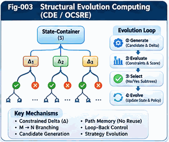

# 003 — Structural Evolution Computing

## From Static Localization to Constrained Delta Evolution and Object-Centric Reasoning

**Status:** Research synthesis and testable architectural proposal  
**Series:** Beyond Static Computation — Five DOI Peaks  
**Version:** 0.1.0 (research draft)  
**Date:** 2026-11-08

> **Central thesis.** Structural Evolution Computing (SEC) is a proposed way to organize computation in which object state, candidate transformations, constraints, evaluators, and selected computational capabilities can evolve together under explicit contracts. It does not claim to invent dynamic algorithms. Its research contribution is a proposed *common structural interface* connecting localization, residual-driven candidate generation, constrained evolution, in-situ reasoning, validation, and relay.

## Abstract

Classical numerical optimization, simulation, online algorithms, incremental computation, control, and reinforcement learning already provide powerful approaches to static and dynamic problems. Yet practical systems often fragment object representation, problem localization, state updates, hypothesis generation, evaluation, and learned capabilities across distinct components. The five-repository sequence—Adversarial Structural Security Intelligence (ASSI), Dynamic Bucket Tree of Permutation (D-BTP), Constrained Delta Evolution (CDE), World Entity and Structural Intelligence Operations (WE-SIO), and Object-Centric Structural Reasoning and Evolution (OCSRE)—suggests a unifying architectural hypothesis. This article develops Structural Evolution Computing as a research program: localized objects expose typed state and residuals; generators propose admissible deltas; constraints and evaluators test them; validated updates become new state and potentially reusable capabilities. We describe the relationship to the Structural Intelligence Framework (SIF) and Relay, define minimal transition contracts, identify risks of self-modifying evaluation and uncontrolled exploration, and propose falsifiable experiments. The framework is an architectural hypothesis, not an established performance result or a replacement for existing algorithms.

**Keywords:** structural intelligence; constrained delta evolution; object-centric computation; localization; residual-first; incremental computation; adaptive search; capability relay; validation.

---



*Proposed structural evolution computing cycle: a state container and constraints delimit candidate delta generation; evaluation, path memory, and validation inform state updates and possible generator improvement. Composable deltas and explicit loop-back rules help control evolution. The architecture must be compared with established dynamic optimization, incremental computation, and adaptive search baselines.*

---

## 1. The View from Five Research Peaks

The sequence is best read as a chain of progressively generalized *questions*, not as a claim that one repository logically proves the next.

| Research peak | Starting question | Structural contribution to this synthesis |
|---|---|---|
| **ASSI** | How can changing identities, evidence, authority, incentives, and dependencies be handled in adversarial systems? | Motivates explicit identity, evidence, trust, constraints, and adversarial feedback. |
| **D-BTP** | How can candidate combinations and explanatory paths be generated and compared directionally? | Motivates dynamic candidate generation, path memory, non-reuse constraints, and competing hypotheses. |
| **CDE** | Can constrained transformations be represented independently of any one domain? | Generalizes state containers, delta semantics, adaptive branching, feasibility, and controlled evolution. |
| **WE-SIO** | Can persistent world entities carry state, relations, computation interfaces, and history? | Supplies an object-centric representation and extensible Core Frame/Plugins boundary. |
| **OCSRE** | Can reasoning, differential computation, learning, and evolution be coordinated around objects? | Proposes an integrated object-centric runtime and governance loop. |

These contributions become particularly interesting when connected to earlier **SIF Localization** and **Relay**: localization selects *where and what* to address; evolution explores *how the selected state could change*; relay transfers validated results and reusable capabilities.

### 1.1 The research question

Can one shared set of typed interfaces support a variety of dynamic problems **without** sacrificing domain-specific algorithms, correctness guarantees, or computational efficiency?

This is narrower and more testable than claiming a universal new theory of computation.

## 2. Reframing the Static–Dynamic Divide

A useful distinction is not simply “static mathematics versus dynamic simulation.” Dynamic programming, online optimization, incremental view maintenance, discrete-event simulation, model predictive control, reinforcement learning, evolutionary algorithms, and adaptive planning already span that divide.

The proposed SEC distinction concerns **what the computational system is allowed to modify**:

1. **Fixed-instance solving:** change solution variables under fixed representations and objectives.
2. **Incremental state maintenance:** update results as input data change.
3. **Adaptive policy optimization:** change a policy or control rule as experience accumulates.
4. **Structural evolution:** under governance, change candidate generators, representation links, plugin composition, and selected evaluation procedures, while retaining independent tests of success.

These are overlapping dimensions, not mutually exclusive categories. Structural evolution is already explored in areas such as program synthesis, AutoML, meta-learning, and evolutionary computation. The proposal here is to connect such mechanisms to a persistent, object-centered, residual-addressable substrate with explicit relay contracts.

## 3. Localization Becomes an Active Computational Interface

SIF Localization can be understood as more than an address lookup. It relates a problem, evidence, residual, or capability request to relevant objects and operators.

A minimal localization request may be represented as:

```text
LocalizationRequest {
  question_or_goal
  object_scope
  evidence_refs
  residual_refs
  constraint_refs
  time_horizon
  resource_budget
  authorization_context
}
```

The output is a set of candidate locations and capabilities, each with provenance and uncertainty. In a static system, that output may only select a solver. In an evolving system, it also determines which local states, relations, and transformation operators become candidates for change.

**Proposed bridge:**

```text
SIF Localization
    -> WE-SIO object / relation scope
    -> Residual and constraint diagnosis
    -> CDE candidate deltas
    -> OCSRE reasoning and validation
    -> Commit / reject / relay
    -> Revised localization knowledge
```

This bridge is a proposed composition. It should not be confused with a proven single algorithm.

## 4. The State–Delta–Constraint Core

Let a versioned structural state be

$$
S_t=(X_t,R_t,G_t,E_t,P_t,H_t,V_t),
$$

where:

- $X_t$: object attributes and current values;
- $R_t$: typed relations and dependency links;
- $G_t$: candidate-generation methods and capability references;
- $E_t$: evaluation methods and benchmarks;
- $P_t$: policies, authorization, and resource controls;
- $H_t$: history, evidence, path memory, and prior residuals;
- $V_t$: versions and provenance.

A candidate delta $\delta$ is a typed proposal to transform some authorized portion of $S_t$. Its application is a *partial* function:

$$
T(S_t,\delta;C_t) \rightarrow
\begin{cases}
(S_{t+1},\pi_t), & \text{if admissible and validated},\\
(\bot,\pi_t), & \text{otherwise},
\end{cases}
$$

where $C_t$ denotes current constraints, $\pi_t$ is a decision/evidence record, and $\bot$ indicates no committed transition.

The important design choice is **not** that all changes are accepted. A proposal must survive authorization, type checking, feasibility checks, and task-specific validation before a state transition is committed.

### 4.1 Delta semantics

A delta should declare:

```text
DeltaProposal {
  delta_id
  target_object_ids
  precondition_state_versions
  operation_type
  payload
  constraint_refs
  generator_id
  expected_effects
  uncertainty
  estimated_cost
  evidence_refs
  rollback_or_compensation_plan
}
```

Operations may be composable or reversible in some domains, but **neither property is universal**. For example, an irreversible physical action or externally visible transaction cannot be made reversible by a software rollback flag. The contract must distinguish reversible, compensatable, and irreversible effects.

### 4.2 Path memory and loop control

D-BTP's path constraints motivate recording whether a particular delta has already been used in a given search path. This can prevent trivial cycling in some searches, but cannot be treated as a universal no-repeat law: iterative control, retry protocols, and some optimization methods legitimately revisit equivalent states. The appropriate invariant is **domain-scoped admissibility**, backed by explicit loop detection, termination budgets, and progress tests.

### 4.3 Adaptive branching

A state may generate $M$ candidate deltas and retain $N$ survivors, with $M$ and $N$ chosen dynamically from budget, uncertainty, and observed value. Branching is a resource allocation policy, not evidence of intelligence by itself.

## 5. Residual as an Active Computational Object

A residual is not necessarily a scalar prediction error. It can be a typed gap between observed and expected behavior, a violated constraint, an unexplained event, an unmet capability, or a disagreement among evaluators.

```text
ResidualRecord {
  residual_id
  source_object_ids
  residual_kind
  observed_vs_expected
  evidence_and_provenance
  uncertainty
  temporal_scope
  candidate_explanations
  priority_and_budget
  resolution_status
}
```

A residual-first architecture retains these records across computation boundaries rather than discarding them after a function returns. The objective is not to maximize residual volume, but to increase the yield of **actionable, validated discoveries per unit of cost**.

Residuals may guide localization, trigger candidate generation, or reveal gaps in a plugin portfolio. Noise filtering, duplicate suppression, false-discovery control, and expiration policies are therefore part of the architecture, not optional refinements.

## 6. WE-SIO: The Persistent Object Substrate

WE-SIO is proposed as a durable semantic frame for identities, states, relations, history, constraints, and plugin references. The key engineering principle is **Core Frame + Plugins**:

- The **Core Frame** specifies stable identity, typed properties, versioning, access control, provenance, residual references, and capability contracts.
- **Plugins** provide SQL access, stream processing, numerical solvers, graph operations, simulation, statistical analysis, CDE search, or model-based reasoning.

An object-native interface does **not** require physical computation to happen inside each object. Execution can be delegated to databases, remote services, accelerators, or agents while maintaining object-level state and evidence semantics.

### 6.1 SQL alignment and incremental updates

A useful entry point is mapping database tables, rows, columns, keys, constraints, and change-data-capture events into versioned WE-SIO objects. But column names alone are insufficient: semantic alignment must preserve units, time semantics, null behavior, provenance, and transaction boundaries. Query pushdown and native database execution should remain available where more efficient than object materialization.

This provides a concrete testbed for SEC: can a data change be converted into a localized residual, candidate transformation, validation event, and reusable insight with acceptable overhead?

## 7. OCSRE: Reasoning and Evolution Around the Object

OCSRE can be studied as an orchestration layer for the following loop:

```text
Observe versioned object state
  -> Identify residual / opportunity
  -> Localize relevant objects and capabilities
  -> Generate constrained delta candidates
  -> Evaluate with domain-specific plugins
  -> Validate independently in a sandbox
  -> Commit, reject, defer, or escalate
  -> Record outcomes and relay reusable findings
  -> Reobserve
```

This loop separates **proposal** from **authorization** and **evaluation** from **commit**. The distinction is essential when the system proposes changes to its own candidate generator or evaluator.

### 7.1 Self-modification requires an external anchor

If a system can change the metric used to judge its own success, it may optimize the metric rather than the intended task. A credible architecture must preserve at least one independent evaluation channel: held-out tests, immutable safety invariants, externally specified objectives, or human approval for consequential changes.

### 7.2 In-situ is logical, not necessarily physical

“In-situ computation” means retaining enough local context and continuity to reason at the point where a relevant state change is recognized. It need not imply a continuously running agent for every object. Sparse activation, event-triggered plugins, shared services, and dynamic attention allocation are compatible with in-situ semantics.

## 8. From Computation to Structural Evolution

A system that merely updates $X_t$ is doing state evolution. A stronger system may propose changes to $G_t$ (candidate generators), $R_t$ (representation and relations), or a governed subset of $E_t$ (evaluation procedures). This is the transition toward *evolution of the discovery process*.

Three nested learning loops are useful:

1. **Task loop:** choose a better action or solution.
2. **Strategy loop:** learn which delta generators and evaluators work for which classes of residuals.
3. **Discovery loop:** propose new relations, capabilities, and questions; validate whether they generalize.

The third loop is an ambitious hypothesis. A growing plugin count or increasing hypothesis volume does not establish emergent intelligence. Evidence must show new, reproducible capabilities or improved generalization at controlled cost.

## 9. Structural Spillover Across Domains

The same high-level interface may connect several very different problem classes:

| Domain | Local state | Residual | Delta candidate | Independent success test |
|---|---|---|---|---|
| Adversarial identity analysis | Evidence graph and time-indexed claims | Unexplained inconsistencies | Revised linkage hypothesis | Precision/recall on protected ground truth; privacy constraints |
| School-bus scheduling | Routes, capacity, pickup windows | Constraint violation or excess fleet cost | Route/assignment change | Feasibility, vehicles, travel time, fairness |
| SQL operations | Versioned rows and relationships | Broken invariant or unexpected change | Query, schema, or rule proposal | Transactional correctness and workload cost |
| Stock time series | Assets, events, relations, history | Prediction discrepancy or regime shift | New predictive hypothesis | Walk-forward out-of-sample utility after costs |
| AI-generated code governance | Calling graph, contracts, tests | Failing contract or uncovered path | Code or test modification | Independent test suite and security checks |

A shared interface is valuable only if its interoperability and reuse benefits exceed translation, storage, scheduling, and governance overhead. Some domains may be better served by specialized existing tools.

## 10. Comparison with Established Approaches

SEC must be evaluated against, not rhetorically contrasted with, mature techniques:

- **Incremental databases and stream processing** already maintain results as data change.
- **Dynamic programming and branch-and-bound** already exploit state, decomposition, and pruning.
- **Model predictive control** repeatedly solves constrained problems under changing conditions.
- **Reinforcement learning and meta-learning** adapt policies and, in some cases, learning procedures.
- **Program synthesis and AutoML** search over program structures and model configurations.
- **Blackboard systems, actor systems, and knowledge graphs** provide precedents for distributed, persistent, or object-oriented coordination.

The proposed differentiator is the **combined contract** across persistent objects, residual localization, delta generation, validation, and reusable relay. Whether this combination is more effective is an empirical question.

## 11. Minimal Conformance Contracts

A first experimental implementation should satisfy these requirements before runtime-scale claims are made.

**C-01 — Identity and version integrity.** Every mutation targets identified, versioned objects; stale writes are detected.

**C-02 — Delta admissibility.** A candidate declares preconditions, effects, constraint scope, and authorization.

**C-03 — Evidence preservation.** Accepted and rejected candidates retain provenance and reason codes.

**C-04 — Independent validation.** Promotion to a deployed capability requires tests not fully controlled by the candidate generator.

**C-05 — Budget and termination.** Search and recursive evolution obey explicit limits and cancellation policies.

**C-06 — Side-effect governance.** External or irreversible actions require appropriate authorization and safe execution boundaries.

**C-07 — Relay interoperability.** A reusable result includes an interface contract, applicability conditions, evidence, version, and known failure modes.

**C-08 — Observability.** The system records latency, compute, storage, discovery yield, false positives, and rollback events.

## 12. Falsifiable Hypotheses

**H-SEC-01 — Incremental structural advantage.** On a dynamic relational workload, a WE-SIO/Residual-driven implementation identifies and resolves selected cross-object anomalies faster than a fixed batch pipeline at equal resource budget.

**H-SEC-02 — Search efficiency.** On constrained scheduling tasks, CDE's typed delta generation and path memory improve feasible-solution quality per evaluation compared with a domain-matched baseline, after tuning effort is controlled.

**H-SEC-03 — Reuse advantage.** A validated delta generator transferred through Relay improves performance on a related but unseen task compared with rebuilding from scratch, including integration costs.

**H-SEC-04 — Discovery advantage.** Persistent object histories and residual registries increase the rate of replicated, nontrivial discoveries relative to stateless event analysis.

**H-SEC-05 — Governance reliability.** Versioned contracts and independent validation reduce harmful or incorrect commits compared with ungoverned adaptive pipelines.

**H-SEC-06 — Net benefit boundary.** There exist workloads for which SEC overhead exceeds benefits; identifying those workloads is part of the research outcome.

Each hypothesis should predeclare metrics, baselines, compute budgets, statistical procedures, and failure criteria. A hypothesis that cannot be falsified should be rewritten.

## 13. Experimental Roadmap

### Phase A — SQL object-change laboratory

Implement a small relational schema with CDC, object mapping, typed residual records, and a few constrained plugin operations. Compare against SQL triggers, incremental views, and standard anomaly detection. Measure semantic correctness, end-to-end latency, memory, and useful discovery yield.

### Phase B — Dynamic school-bus scheduling

Use a synthetic but reproducible dataset with pickup windows, capacity, fleet limits, and route constraints. Compare CDE-style candidate generation with local search, constraint programming, and heuristic baselines. Report feasibility first; optimize fleet count, rider time, and cost only within the feasible set.

### Phase C — Cross-task relay

Transfer a validated capability from one scheduling instance or anomaly class to another. Require an explicit capability contract and measure transfer gain *net of adaptation cost*.

### Phase D — Stock-data stress test

Use historical data only for exploratory hypothesis generation and properly isolated later periods for validation. Apply leakage prevention, multiple-testing correction, regime sensitivity analysis, realistic trading frictions, and no-live-trading defaults. No positive financial result should be inferred from in-sample fit.

### Phase E — Evolution of discovery

Allow candidate generators to be proposed as versioned plugin upgrades. Evaluate against frozen independent benchmarks, including adversarial cases and regression suites. Track whether the system improves discovery yield without evaluator gaming or uncontrolled complexity.

## 14. Open Questions and Critical Boundaries

1. What is the smallest state/delta/residual schema that retains cross-domain usefulness without becoming an overly generic abstraction?
2. When is object-native representation superior to relational, graph, or event-native computation—and when should it defer to them?
3. Which transformations require exact reversibility, which permit compensation, and which must be prohibited?
4. How should local residual priorities be reconciled with global system objectives and shared compute budgets?
5. Can the framework distinguish novel reusable structure from repeated rediscovery of known patterns?
6. How can evaluator evolution be allowed without losing an external standard of correctness?
7. What forms of path non-reuse are sound for combinatorial search but inappropriate for control or stochastic systems?
8. How should concurrent updates and distributed agents handle conflicts, consistency, and provenance?
9. What constitutes a genuine cross-domain capability relay rather than a relabeled integration adapter?
10. What evidence would justify calling a persistent discovery loop *emergent intelligence* rather than sophisticated automation?

### Research divergences worth preserving

- **General architecture vs. new computational paradigm:** The present paper uses the former as its defensible claim and leaves the latter open.
- **Universal presence vs. selective in-situ activation:** Logical coverage and physical resource allocation should be separately specified and measured.
- **Residual-first vs. residual-native:** Prioritizing residuals does not automatically require every computational operation to be organized around them.
- **Discovery engine vs. general evolving intelligence:** A measurable discovery laboratory is an experimental entry point, not a ceiling on the broader hypothesis.

## 15. Conclusions: What the Five Peaks Make Visible

The research progression from ASSI through D-BTP, CDE, WE-SIO, and OCSRE suggests a possible transition from *algorithms acting on externally prepared data* to *persistent structural systems that localize problems, retain residuals, generate and validate constrained transformations, and relay reusable capabilities*. The important insight is not that computation can be dynamic—this is well established—but that **the boundaries among representation, computation, evaluation, and learning may themselves become explicit, governable objects of evolution**.

The proposal has substantial engineering promise, but its novelty and practical advantage remain to be established through comparisons with strong existing systems. A productive next step is not a universal runtime claim; it is a small, reproducible, specification-first laboratory in which every claimed advantage can be measured, challenged, and transferred.

**Research relay principle:** Preserve the observation, the proposed mechanism, the evidence status, the disagreement, and the test that could change the conclusion. That is more useful to collective learning than a polished claim of inevitability.

---

## Source Repositories and Research Lineage

The following repositories are the five primary research inputs to this synthesis. Repository titles and descriptions are attributed to their respective projects; this article proposes a cross-repository interpretation and does not claim to be a verbatim summary of their full contents.

1. **ASSI — Adversarial Structural Security Intelligence**  
   https://github.com/sizhet/Adversarial-Structural-Security-Intelligence
2. **D-BTP — Dynamic Bucket Tree of Permutation**  
   https://github.com/sizhet/Dynamic-Bucket-Tree-of-Permutation-and-Directional-Structural-Evolution
3. **CDE — Constrained Delta Evolution**  
   https://github.com/sizhet/Constrained-Delta-Evolution
4. **WE-SIO — World Entity and Structural Intelligence Operations**  
   https://github.com/sizhet/World-Entity-and-Structural-Intelligence-Operations
5. **OCSRE — Object-Centric Structural Reasoning and Evolution**  
   https://github.com/sizhet/Object-Centric-Structural-Reasoning-and-Evolution

Related structural-intelligence lineage:

- **SIF — Structural Intelligence Framework:** https://github.com/sizhet/Structural-Intelligence-Framework
- **UIERU — Universal Intelligence Evolution and Relay Unit:** https://github.com/sizhet/Universal-Intelligence-Evolution-and-Relay-Unit
- **UCPSF — Universal Control Planes and Scoring Folding:** https://github.com/sizhet/Universal-Control-Planes-and-Scoring-Folding

### Series continuity

- **001 — Five DOI Peaks:** overarching research observations.
- **002 — WE-SIO Object-Native Intelligence:** persistent object semantics and engineering interfaces.
- **003 — Structural Evolution Computing:** this article.
- **004 — Residual-First In-Situ Intelligence:** residuals and local intelligence as primary computation objects.
- **005 — Persistent Structural Discovery:** continuously observing, testing, and relaying new patterns.
- **006 — Intelligence Spillover and Relay:** transfer, open interfaces, and collective learning.

