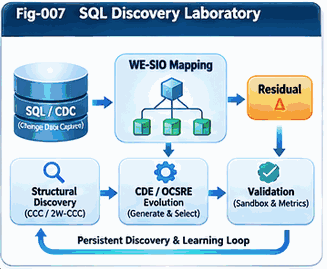

# EXP-001 — SQL Structural Discovery Laboratory

**Status:** Proposed experimental protocol (not an implemented or validated system)  
**Version:** 0.1.0  
**Research program:** Beyond Static Computation — Object-Centric Structural Evolution and Persistent Intelligence  
**Related specifications:** SPEC-001 (Object–Residual–Delta Interfaces), SPEC-002 (Persistent Discovery Loop), SPEC-003 (Validation and Relay Contracts)

## Abstract

This experiment tests whether a persistent, object-centric discovery system can identify, validate, and relay useful structural relationships in evolving relational databases more effectively than conventional rules, batch analysis, and streaming anomaly detection. SQL tables and change-data-capture (CDC) events are aligned to World Entity and Structural Intelligence Operations (WE-SIO) objects without replacing the database engine. Residuals are retained as first-class, provenance-bearing records; candidate CCC, Two-Way CCC, and pattern triggers are proposed and subjected to independent evaluation. Constrained Delta Evolution (CDE) and Object-Centric Structural Reasoning and Evolution (OCSRE) may adapt discovery policies in isolated sandboxes. The primary outcome is **validated, nonredundant discovery utility per unit total cost**, not the number of patterns generated.

---



*Proposed SQL discovery laboratory: database snapshots and change-data-capture events are aligned to persistent WE-SIO objects; residual registration and candidate relationship discovery feed sandbox tests and independent validation. Baseline comparisons distinguish gains from object persistence, residual retention, discovery policy, and other components.*

---

## 1. Research question and scope

Can WE-SIO alignment, persistent residual memory, and governed structural discovery yield measurable improvements in discovering useful, reproducible cross-table and temporal relationships in SQL workloads?

This is a *discovery* experiment, not a claim that WE-SIO supersedes relational databases, SQL query optimization, causal inference, or established streaming analytics. It tests integration benefits and overhead under explicit constraints.

**In scope:** schema mapping; CDC ingestion; semantic constraints; cross-object residuals; candidate pattern generation; independent validation; bounded decision recommendations; capability packaging and relay.

**Out of scope:** autonomous writes to production databases, inference of private individual identities, unconstrained agent execution, and claims of general intelligence emergence from isolated correlations.

## 2. Falsifiable hypotheses

- **H-SQL-01 — Alignment fidelity:** WE-SIO materialization preserves declared relational identities, column semantics, event order, and source provenance within predeclared tolerances.
- **H-SQL-02 — Residual retention:** A persistent residual registry improves *validated* discovery recall or time-to-detection over a matched ephemeral-residual baseline at comparable total cost.
- **H-SQL-03 — Cross-object discovery:** CCC/Two-Way CCC discovery identifies more independently validated, nonredundant relationships than fixed rules and generic streaming anomaly detection.
- **H-SQL-04 — Adaptive evolution:** Governed CDE/OCSRE policy adaptation improves future-window discovery utility over a frozen discovery policy, without increasing false discovery or risk beyond predeclared limits.
- **H-SQL-05 — Relay:** A receiving implementation can reproduce a transferred finding or capability from its contract, provenance, and validation package without relying on hidden sender state.

All hypotheses permit null or negative outcomes. Report effect sizes, uncertainty, and cost, not only statistical significance.

## 3. Experimental data and scenarios

Use synthetic or appropriately licensed, de-identified relational datasets with a reproducible event generator. Maintain separate datasets for development, confirmation, and cross-domain transfer.

### 3.1 Reference schema

| Table | Key fields | Example structural role |
|---|---|---|
| `customers` | `customer_id`, `region`, `created_at` | Entity identity and attributes |
| `orders` | `order_id`, `customer_id`, `ordered_at`, `status` | Transaction state and temporal events |
| `order_items` | `order_id`, `item_id`, `qty`, `unit_price` | Cross-table quantities and constraints |
| `inventory` | `item_id`, `warehouse_id`, `on_hand`, `updated_at` | Dynamic resource state |
| `shipments` | `shipment_id`, `order_id`, `shipped_at`, `delivered_at` | Process relations and delays |
| `events` | `event_id`, `entity_ref`, `event_time`, `ingested_at`, `event_type` | CDC-like observations and lateness |

Use explicit foreign keys where available; include controlled cases with missing keys, slowly changing dimensions, late events, and evolving schemas. All timestamps must have declared time zones and event-time versus processing-time semantics. Currency and units must be explicit.

### 3.2 Injected discovery targets

Generate a sealed ground-truth manifest (not accessible to discovery algorithms) covering:

1. Cross-table invariant violations (e.g., impossible shipment state).
2. Time-lagged associations between inventory changes and delivery delays.
3. Conditional patterns visible only after segmentation or temporal alignment.
4. Bidirectional evidence candidates with asymmetric conditional strength.
5. Concept drift, schema changes, and deliberately spurious correlations.
6. Novel combinations of known primitives requiring a new trigger or capability.

For each injection, record causal generation mechanism, activation window, expected observability, and whether it is actionable. Distinguish a synthetic *causal mechanism* from a pattern merely correlated with it.

## 4. WE-SIO alignment contract

Map each SQL entity or relation to a stable WE-SIO identity with a declared namespace and key policy. Preserve row-level source references rather than duplicating all raw data. A column mapping records datatype, unit, null semantics, temporal scope, provenance, and applicable constraints.

```yaml
object_id: "we://lab/orders/ord-1042"
source:
  system: "sql-lab"
  table: "orders"
  primary_key: {order_id: "ord-1042"}
  schema_version: "v1"
state:
  status: "shipped"
  ordered_at: "2026-01-15T10:00:00Z"
relations:
  customer: "we://lab/customers/c-17"
provenance:
  source_event_id: "cdc-8821"
  observed_at: "2026-01-15T10:00:03Z"
  source_commit_position: "opaque-log-position"
capability_refs: ["validate_order_lifecycle@1"]
```

This YAML is illustrative, not a normative serialization. A production contract must specify idempotency, deletes/tombstones, transaction boundaries, replays, late arrivals, and version conflicts. No plugin may silently reinterpret missing values or units.

## 5. Persistent discovery loop

1. **Observe:** ingest snapshots and CDC events, maintaining transaction-aware offsets.
2. **Align:** update affected WE-SIO objects and relation indexes; quarantine invalid mappings.
3. **Detect:** compare observations with declared invariants, forecasts, and previously learned structural expectations.
4. **Register:** store typed residuals with evidence, uncertainty, provenance, and deduplication keys.
5. **Localize:** select promising objects, relationships, and time windows under a compute budget.
6. **Generate:** propose CCC, Two-Way CCC, temporal rules, and pattern-trigger candidates.
7. **Test:** evaluate candidates on sandboxed historical and forward-held-out streams, correcting for multiple testing.
8. **Validate:** independently assess novelty, reproducibility, utility, and stability.
9. **Act or relay:** publish read-only recommendations or approved capability packages; never automatically mutate production state.
10. **Feedback:** retain successful, failed, and inconclusive candidates for future comparisons and controlled policy evolution.

### 5.1 Minimal record interfaces

```yaml
residual:
  residual_id: "res-220"
  object_refs: ["we://lab/orders/ord-1042"]
  kind: "constraint_discrepancy"
  observed_event_refs: ["cdc-8821"]
  expected_rule_ref: "order-lifecycle@1"
  evidence_window: ["2026-01-15T00:00:00Z", "2026-01-16T00:00:00Z"]
  uncertainty: {type: "rule_based", note: "pending reconciliation"}
  status: "candidate"

discovery_candidate:
  candidate_id: "cand-31"
  hypothesis: "A delayed inventory update predicts a shipment delay in segment S"
  object_refs: ["we://lab/orders/ord-1042"]
  residual_refs: ["res-220"]
  proposed_trigger_ref: "trigger-inventory-delay@candidate"
  evidence_refs: ["evidence-44"]
  status: "unvalidated"
```

A *CCC* is treated here as a candidate conditional/conceptual structural connection under the program's CCC semantics, not as proof of causation. Two-Way CCC must explicitly store evidence in both directions; the existence of two conditional associations does not imply symmetry, causality, or independent corroboration.

## 6. Comparison arms and ablations

| Arm | System | Purpose |
|---|---|---|
| B0 | Fixed SQL checks and scheduled queries | Conventional deterministic baseline |
| B1 | CDC + established streaming anomaly detection | Event-driven baseline |
| B2 | Online statistical discovery / AutoML with matched features | Adaptive non-WE-SIO baseline |
| A1 | WE-SIO alignment + fixed detection rules | Isolate object representation cost/benefit |
| A2 | A1 + persistent residual registry | Isolate residual memory |
| A3 | A2 + CCC/Two-Way CCC discovery and trigger validation | Isolate structural discovery |
| A4 | A3 + sandboxed CDE/OCSRE adaptation | Test evolution of discovery policies |

Use the same source events, train/test windows, allowed external data, and compute budget across arms. Also report equal-latency comparisons where feasible. Run ablations removing provenance, temporal relations, residual memory, and policy adaptation. Do not compare an unconstrained adaptive system against deliberately weak fixed rules alone.

## 7. Evaluation and success criteria

**Primary metric:** independently validated, nonredundant, actionable discoveries per 100 compute-hours (or a declared equivalent cost unit), with confidence intervals.

**Secondary metrics:** precision, recall against injected truth, false-discovery rate, time-to-detection, validation latency, reproducibility across seeds, downstream decision benefit, cross-domain transfer success, storage overhead, operator review time, and total cost of ownership.

A discovery counts as *validated* only if it passes preregistered evidence and holdout tests, has a stable semantic description, and is not equivalent to an existing rule. Actionability requires a specified decision and utility measure; predictive value alone is insufficient.

Predeclare numeric thresholds in an experiment manifest before running confirmatory tests; no universal success threshold is asserted here. Use temporal splits with embargo where leakage is possible, repeated seeds, and correction for the size of the hypothesis search. Report negative results and all tested candidate counts.

## 8. Controlled CDE/OCSRE evolution

Allowed candidate Deltas include changes to observation granularity, relation traversal depth, residual prioritization, trigger thresholds, and plugin selection. Every Delta must specify its parent policy version, constraints, predicted effect, sandbox evaluation, and rollback procedure.

```yaml
delta_id: "delta-policy-07"
parent_policy: "discovery-policy@3"
operation: "adjust_residual_priority"
constraint_refs: ["budget@1", "no-production-writes@1"]
validation_plan: "forward_holdout_2026q1"
status: "sandbox_only"
```

Policy evolution must not alter confirmatory ground truth or independent scoring rules. If evaluation rules themselves evolve, compare against an externally frozen audit metric. Enforce finite search budgets, path-memory constraints where relevant, and loop termination.

## 9. Governance and adversarial tests

Apply ASSI-informed threat modeling to forged CDC events, poisoned source rows, malicious plugin outputs, false provenance, replay attacks, privilege escalation, and feedback manipulation. Run plugins with least privilege. Audit every promotion from candidate to validated to authorized. Protect confidential data and prohibit unauthorized entity linkage.

A false positive must not directly trigger operational action. A valid statistical discovery does not authorize intervention. Maintain human review or a separately approved policy for any consequential action.

## 10. Relay artifact and independent replication

For each validated discovery, export a Capability Relay Package containing:

- Semantic claim and scope, including known exclusions.
- Source-schema and WE-SIO mapping contracts.
- Trigger or algorithm specification and versioned dependencies.
- Dataset manifest or reproducible synthetic generator.
- Evaluation protocol, results, uncertainty, and negative tests.
- Security/privacy constraints and execution permissions.
- Open residuals, failures, and unresolved divergences.

A second implementation must re-run the package on a separately generated or withheld dataset, report mapping failures, and independently confirm or reject the claimed benefit. Transfer is not established by successful deserialization alone.

## 11. Milestones and exit gates

| Gate | Deliverable | Exit requirement |
|---|---|---|
| M0 | Registered hypotheses and dataset generator | Sealed truth, split policy, baseline definitions |
| M1 | SQL/CDC → WE-SIO mapper | Identity, ordering, replay, and provenance conformance tests pass |
| M2 | Residual registry and fixed discovery | Residual lifecycle and deduplication auditable |
| M3 | CCC / trigger discovery | Independent holdout validation and false-discovery accounting |
| M4 | CDE/OCSRE sandbox | Policy changes reproducible, bounded, and reversible |
| M5 | Cross-system relay | Independent recipient reproduces or transparently rejects claim |

A failed gate is a research result. Record the failure and do not silently advance the corresponding capability status.

## 12. Illustrative test cases

- **TC-01:** A CDC event is replayed twice; object state and residual counts remain idempotent.
- **TC-02:** Two related table changes arrive out of order; no premature invariant violation is promoted.
- **TC-03:** A column changes unit or type; mapping rejects or explicitly migrates semantics.
- **TC-04:** A cross-table anomaly is injected; detection delay and provenance are measured.
- **TC-05:** A spurious temporal pattern appears only in training; confirmatory validation rejects it.
- **TC-06:** A Two-Way CCC candidate has strong evidence in one direction but weak evidence in the reverse; evidence remains direction-specific.
- **TC-07:** An evolved discovery policy increases candidate count but reduces validated utility; it is not promoted.
- **TC-08:** A receiving lab lacks a required plugin; relay reports an explicit capability residual.

## 13. Expected contributions and limitations

The experiment could establish an evidence-based engineering account of object-native alignment, residual-native discovery, and bounded structural evolution over SQL data. It could also show that existing stream processing and online learning already capture most benefits more cheaply. Both outcomes are informative.

Key limitations include synthetic-to-real transfer, schema heterogeneity, imperfect causal identification, selection bias, data privacy, and the operational expense of maintaining persistent object and residual histories. A successful SQL experiment would **not** by itself establish general intelligence emergence or universal superiority of CDE/OCSRE.

## 14. Open questions

1. Which residuals should be retained versus compressed or expired?
2. When does object alignment improve discovery enough to offset mapping and storage overhead?
3. How should bidirectional evidence be scored without confusing association and causation?
4. Which discovery-policy Deltas generalize across unrelated schemas?
5. What minimal relay contract enables a truly independent implementation?
6. How can exploration budgets avoid overlooking rare but consequential structural changes?

## 15. Related research and repositories

This experiment integrates, without superseding, the following research programs:

- [ASSI — Adversarial Structural Security Intelligence](https://github.com/sizhet/Adversarial-Structural-Security-Intelligence)
- [D-BTP — Dynamic Bucket Tree of Permutation](https://github.com/sizhet/Dynamic-Bucket-Tree-of-Permutation-and-Directional-Structural-Evolution)
- [CDE — Constrained Delta Evolution](https://github.com/sizhet/Constrained-Delta-Evolution)
- [WE-SIO — World Entity and Structural Intelligence Operations](https://github.com/sizhet/World-Entity-and-Structural-Intelligence-Operations)
- [OCSRE — Object-Centric Structural Reasoning and Evolution](https://github.com/sizhet/Object-Centric-Structural-Reasoning-and-Evolution)

**Companion documents:** `002-WE-SIO-Object-Native-Intelligence.md`, `004-Residual-First-In-Situ-Intelligence.md`, `005-Persistent-Structural-Discovery.md`, `TESTABLE-HYPOTHESES.md`, and `VALIDATION-ROADMAP.md`.

---

**Research status notice:** All schemas, examples, and experiment targets in this document are proposals. No experimental results or validated performance advantages are claimed.
