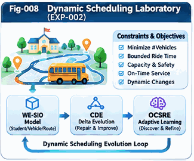

# EXP-002 — Dynamic Scheduling Laboratory

**Subtitle:** Testing Constrained Delta Evolution, Object-Centric Structural Reasoning, Residual-First Adaptation, and Capability Relay in Dynamic School Transportation

**Status:** Research experiment specification — proposed, not executed  
**Version:** 1.0.0  
**Date:** 2026-11-08  
**Companion:** EXP-001-SQL-Discovery-Lab.md; EXP-003-Stock-Pattern-Lab.md

## Abstract

This laboratory tests whether a persistent object-centric structural intelligence system can improve the quality, responsiveness, and transferability of solutions to dynamic school-bus scheduling problems. School transportation provides explicit operational constraints and measurable objectives, yet frequent changes in student demand, pickup windows, travel time, vehicle availability, and routing rules. It is therefore a useful testbed for separating the contribution of dynamic state representation, residual retention, constrained delta generation, discovery-policy evolution, and relay. The proposed WE-SIO / CDE / OCSRE stack is compared against static optimization, rolling-horizon replanning, incremental repair, and established adaptive heuristics under equalized resource budgets. The experiment does not assume that structural evolution will outperform conventional optimization. Its objective is to identify the conditions under which it does, the costs of doing so, and the cases in which it fails.

---



*Dynamic school transportation serves as a constrained evolution testbed. Changes in students, stops, vehicles, or travel conditions generate residuals and candidate schedule deltas; safety, capacity, timing, and service constraints gate repairs. CDE/OCSRE proposals are compared against reoptimization, rolling-horizon repair, and adaptive search under matched budgets.*

---

## 1. Research Position and Scope

This is the second proposed experimental pool for persistent structural discovery. Unlike the SQL discovery laboratory, which emphasizes semantic alignment and discovery of data relations, this laboratory emphasizes **feasible state transitions and controlled evolution under changing constraints**.

The initial problem is school transportation: assign students to vehicles and construct feasible routes and schedules, minimizing the number of vehicles while protecting ride duration, safety, punctuality, and service fairness. The experiment uses synthetic or appropriately de-identified operational data. It does not require access to student identities or live dispatch systems.

**In scope:** dynamic vehicle routing, assignment, capacity, pickup/drop-off windows, residual tracking, repair, candidate delta generation, evaluation, simulation, governance, and transfer across instances.

**Out of scope:** claims of optimality without proof, unsupervised live dispatch, speculative AGI claims, or unrestricted self-modification.

## 2. Research Questions

- **RQ-01:** Does preserving structured residuals improve response to recurring schedule disruptions compared with recomputation or stateless repair?
- **RQ-02:** Can CDE generate and validate useful state changes across assignment, route, and scheduling levels without breaking hard constraints?
- **RQ-03:** Does an object-centric state model reduce synchronization and reconstruction costs in a dynamic setting?
- **RQ-04:** Can OCSRE adapt the choice of repair operators and neighborhood structures based on past outcomes?
- **RQ-05:** Can learned structural capabilities transfer to new school networks, demand regimes, or fleet configurations?
- **RQ-06:** Under what disruption rates, problem sizes, and compute budgets does the proposed architecture lose to established baselines?

## 3. Formal Problem Model

Let the system at time `t` contain students `U_t`, vehicles `V_t`, stops `P_t`, routes `R_t`, travel-time estimates `T_t`, and operational constraints `C_t`.

A candidate schedule `x_t` maps students to eligible vehicles, stops, and arrival/departure times. The feasible set is `F(C_t)`. A schedule must satisfy all hard constraints, including vehicle capacity, eligibility, service windows, route continuity, and safety rules.

The objective is **lexicographic** rather than a weighted score that could silently trade safety for fleet savings:

1. Satisfy all hard constraints, or report infeasibility with evidence.
2. Minimize vehicles used, subject to hard constraints.
3. Minimize excessive ride time and lateness.
4. Minimize travel distance, operational cost, and disruptive reassignment.
5. Monitor distributional fairness across students and neighborhoods.

An optional scalar objective may be used only within a lexicographic tier and must publish its weights and normalization. Results must report each metric separately.

A CDE transition is a proposed `delta_t` applied to `state_t`, yielding `state_(t+1)` only if version, path, authorization, and feasibility contracts pass. Candidate generation may include move, swap, route split/merge, vehicle reassignment, departure-time adjustment, and multi-step composed deltas. Delta histories prevent prohibited repetition within a defined search path; they must not globally ban valid operations in unrelated branches.

## 4. Object and Residual Representation

### 4.1 WE-SIO object families

| Object | Identity and state | Relevant capabilities |
|---|---|---|
| StudentRequest | Pseudonymous ID, stop, service window, accessibility requirements | Eligibility and time-window validation |
| Vehicle | Capacity, availability, location, restrictions | Route feasibility and capacity evaluation |
| Stop | Coordinates or graph node, boarding rules, time windows | Travel-time lookup and clustering |
| Route | Ordered stops, assignments, travel-time profile | Local repair and route evaluation |
| Schedule | Versioned global assignment and objective vector | Snapshot, compare, commit, rollback |
| DisruptionEvent | Timestamp, source, affected entities, uncertainty | Impact analysis and trigger routing |
| Residual | Unresolved discrepancy, constraint conflict, or improvement opportunity | Candidate localization and follow-up |
| DeltaCandidate | Preconditions, affected objects, edit set, evaluation history | Sandbox evaluation and commit gating |

### 4.2 Residual classes

- **Constraint residual:** an unserved request, over-capacity segment, infeasible time window, or violated eligibility condition.
- **Optimization residual:** a feasible but potentially avoidable vehicle, excessive route overlap, or unnecessary travel.
- **Prediction residual:** observed travel time differs from expected travel time.
- **Stability residual:** a proposed improvement causes excessive schedule churn.
- **Capability residual:** existing repair operators fail to address a recurring disruption pattern.
- **Evaluation residual:** different evaluators disagree about the ranking or feasibility of candidates.

A residual is not automatically an opportunity. It carries provenance, uncertainty, severity, cost-to-investigate, and validation status.

## 5. Dynamic Event Scenarios

The benchmark should include reproducible event streams with controlled severity:

1. **Demand additions and cancellations:** late enrollment, absent students, changed pickup requests.
2. **Vehicle unavailability:** breakdowns, late arrivals, or capacity reduction.
3. **Travel-time shifts:** congestion or road closure changing the travel-time matrix.
4. **Constraint updates:** new school bell times, accessibility needs, or service policies.
5. **Compound disruptions:** simultaneous demand, fleet, and travel-time changes.
6. **Distribution shifts:** previously unseen demand clusters or school-network topologies.
7. **Adversarial or faulty inputs:** stale events, duplicated updates, invalid vehicle states, and conflicting constraints.

All generated event streams must be seeded and logged. Test partitions should include held-out networks and held-out disruption regimes, not merely new random seeds on the same network.

## 6. Reference Architecture

```text
Demand / Fleet / Travel Events
              |
              v
Versioned WE-SIO Object State
              |
              v
Residual Registry + Impact Localization
              |
              v
Opportunity / Repair Candidate Queue
              |
              v
CDE Delta Generator + Operator Portfolio
              |
              v
Sandbox Feasibility + Objective Evaluation
              |
              v
Independent Validation + Authorization Gate
              |
         +----+-----+
         |          |
      Commit      Reject / Retain Residual
         |          |
         +----+-----+
              v
Outcome Feedback + OCSRE Policy Adaptation
              |
              v
Validated Capability / Relay Package
```

The control plane governs compute budgets, operator permissions, evidence quality, rollback, and deployment. In-situ means retaining identity, history, and computation context at the relevant logical object, not requiring every computation to run physically inside an object.

## 7. Baselines and Ablations

Use at least the following systems, each with documented implementations and equivalent hardware and wall-clock budgets:

| ID | System | Purpose |
|---|---|---|
| B0 | Static solve from scratch after each event | Reoptimization reference |
| B1 | Rolling-horizon optimization | Standard dynamic planning reference |
| B2 | Incremental local repair | Low-latency operational reference |
| B3 | Adaptive large-neighborhood search or equivalent | Strong adaptive heuristic reference |
| B4 | WE-SIO representation with fixed operators, no residual history | Representation contribution |
| B5 | B4 plus structured residual registry | Residual contribution |
| B6 | B5 plus CDE candidate generation, fixed policy | Delta-evolution contribution |
| B7 | Full WE-SIO + CDE + OCSRE, with controlled policy adaptation | Integrated system |

Where tractable, use a mixed-integer solver to establish optimality gaps or lower bounds. Report solver timeouts explicitly. The full system should also be tested without Relay, without cross-instance memory, and without evaluator adaptation to identify which component actually contributes improvement.

## 8. Hypotheses and Falsification

**H-EXP2-01 — Residual continuity:** On repeated or related disruptions, B5 yields lower cumulative repair cost or latency than B4 under equal budgets. **Falsified** if the effect is absent or reversed across preregistered regimes.

**H-EXP2-02 — Constraint-preserving deltas:** CDE can compose multi-object edits with a lower rate of invalid proposed commits than an unconstrained edit generator. **Falsified** if it fails to improve validity or creates unacceptable search overhead.

**H-EXP2-03 — Adaptation benefit:** B7 achieves better held-out quality/latency tradeoffs than B6. **Falsified** if policy adaptation produces no robust out-of-sample gain.

**H-EXP2-04 — Structural transfer:** A capability learned on one network improves performance on another after local revalidation. **Falsified** if transferred operators systematically underperform matched local baselines.

**H-EXP2-05 — Net engineering value:** B7 improves a preregistered utility measure after including compute, storage, integration, and validation costs. **Falsified** if gross schedule gains are erased by system overhead.

These hypotheses must be assessed with confidence intervals, effect sizes, and failure-regime analysis rather than isolated best-case runs.

## 9. Experimental Protocol

### Phase E0 — Dataset and benchmark contracts

Define instance generators, service constraints, disruption distributions, train/validation/test partitions, objective hierarchy, safety requirements, and baselines. Freeze held-out test scenarios before tuning.

### Phase E1 — State and interface conformance

Validate Object, Residual, and Delta schemas; event ordering; state versions; deterministic replay; stale-write rejection; rollback; and access controls.

### Phase E2 — Static and dynamic baseline calibration

Run B0–B3 across increasing network sizes and event rates. Establish feasibility, cost, latency, and known bounds. Document all hyperparameters and time limits.

### Phase E3 — Residual-first and CDE ablations

Compare B4–B6. Test whether structured residuals support better localization and whether constrained deltas reduce search waste. Include counterexamples with misleading residuals.

### Phase E4 — OCSRE adaptation and discovery

Enable controlled adaptation of operator selection and candidate neighborhoods. Require each proposed new strategy to pass an independent held-out validation gate before promotion.

### Phase E5 — Relay and cross-network transfer

Package successful repair patterns with interface contracts, applicability conditions, provenance, negative cases, and reproducible tests. Revalidate on a different network or by an independent implementation.

## 10. Metrics and Reporting

**Feasibility and safety:** hard-constraint violation count, invalid-commit rate, unserved requests, missed windows, rollback success.

**Operational quality:** vehicles used, average and 95th-percentile ride duration, lateness, travel distance, reassignment count, fairness gaps.

**Responsiveness:** event-to-feasible-plan latency, event-to-approved-plan latency, 95th-percentile compute time, solver timeout rate.

**Learning and discovery:** valid novel repair operators, held-out operator gain, residual closure rate, repeat-failure reduction, policy regret against a fixed-operator baseline.

**Resources and relay:** CPU/GPU time, memory, state-storage overhead, engineering effort, transfer acceptance rate, cross-network benefit.

Report results by disruption regime and instance size. A solution with fewer buses but unsafe or infeasible routes is not an improvement. A strategy discovered on training instances must not be described as transferable until independent testing confirms it.

## 11. Illustrative Interface Records

```yaml
schema_version: "0.1"
event:
  event_id: "evt-0042"
  type: "vehicle_unavailable"
  observed_at: "2026-11-08T08:15:00Z"
  affected_object: "vehicle-07"
  source: "synthetic-benchmark"
  confidence: 1.0
state:
  schedule_id: "schedule-001"
  base_version: 18
residual:
  residual_id: "res-0102"
  type: "constraint"
  affected_objects: ["route-12", "vehicle-07"]
  status: "open"
delta_candidate:
  delta_id: "delta-0231"
  base_version: 18
  operator: "reassign_and_retime"
  preconditions: ["vehicle-07-unavailable"]
  sandbox_result: "pending"
  authorization: "not_granted"
```

This is illustrative schema content, not a claim that a compatible runtime exists. The production contract must also specify units, time zones, identity rules, idempotency, event ordering, and conflict resolution.

## 12. Minimum Conformance Tests

| Test | Required behavior |
|---|---|
| CT-01 | Reject a delta based on a stale schedule version |
| CT-02 | Prevent capacity or accessibility violations from being committed |
| CT-03 | Preserve event provenance through residual and delta records |
| CT-04 | Replay an event stream deterministically under fixed seeds |
| CT-05 | Reject duplicate or out-of-order events according to declared policy |
| CT-06 | Preserve valid route continuity after multi-object edits |
| CT-07 | Roll back a failed commit without corrupting unrelated state |
| CT-08 | Keep infeasibility evidence when no safe schedule exists |
| CT-09 | Respect candidate-generation compute budgets and termination rules |
| CT-10 | Block policy promotion without independent validation |
| CT-11 | Revalidate transferred operators against destination constraints |
| CT-12 | Report safety and service metrics separately from aggregate utility |

## 13. Threats to Validity

- **Benchmark simplicity:** synthetic networks may omit operational constraints and human preferences.
- **Unfair baselines:** weak or undertuned comparators can exaggerate the value of structural methods.
- **Data leakage:** using future disruptions to guide operator discovery invalidates claims of online adaptation.
- **Evaluator drift:** a policy that changes its own success criteria may appear to improve without improving service.
- **Overhead hiding:** maintaining object and residual registries may cost more than the optimization benefit.
- **Nonstationarity:** gains under one demand regime may disappear when the network changes.
- **Safety externalities:** optimization must not convert risk, accessibility, or student inconvenience into hidden costs.

Mitigations include preregistration, independent feasibility checks, held-out scenarios, matched budgets, versioned evaluator definitions, and publication of negative results.

## 14. Deliverables and Relay Package

A complete experiment release should include:

- A versioned benchmark specification, synthetic datasets, seeds, and event-stream generator.
- Object/Residual/Delta schemas and conformance results.
- Baseline configurations, solver versions, hardware descriptions, and runtime limits.
- Evaluation scripts, disaggregated metrics, and confidence intervals.
- A discovery log of successful, failed, and retired candidate strategies.
- A Capability Relay Package for any validated reusable operator, with applicability limits and destination revalidation tests.
- A residual and open-questions register documenting unresolved cases.

No positive result should be described as a general proof of intelligence emergence. The stronger claim requires evidence that the system improves its **ability to discover and validate useful operators**, not merely its ability to tune one fixed schedule.

## 15. Relationship to the Research Program

This experiment operationalizes the research chain:

`ASSI (adversarial and changing constraints) → D-BTP (directional candidate generation) → CDE (constrained delta evolution) → WE-SIO (persistent object representation) → OCSRE (reasoning, validation, and adaptive structural learning)`.

It complements **EXP-001**, which focuses on SQL-based discovery, and **EXP-003**, which will address nonstationary financial time series. The laboratory also tests whether CDE can serve as a dynamic Localization pillar within the Structural Intelligence Framework (SIF), while control-plane governance and Relay provide bounded, auditable improvement.

## 16. Open Research Questions

1. Which residual classes provide measurable information beyond ordinary solver diagnostics?
2. How should path-local delta nonreuse interact with rollback and revisiting previously valid states?
3. When is full reoptimization preferable to persistent in-situ repair?
4. Can adaptive operator generation outperform well-tuned large-neighborhood search under matched budgets?
5. Which forms of capability transfer remain useful across different network topologies?
6. How should a system represent infeasibility without encouraging unsafe constraint relaxation?
7. What independent criteria are sufficient to recognize improvement in the discovery mechanism itself?
8. How should the system choose between local repair, global regeneration, and deliberate exploration?

## 17. Source Research Repositories

- [Adversarial Structural Security Intelligence (ASSI)](https://github.com/sizhet/Adversarial-Structural-Security-Intelligence)
- [Dynamic Bucket Tree of Permutation (D-BTP)](https://github.com/sizhet/Dynamic-Bucket-Tree-of-Permutation-and-Directional-Structural-Evolution)
- [Constrained Delta Evolution (CDE)](https://github.com/sizhet/Constrained-Delta-Evolution)
- [World Entity and Structural Intelligence Operations (WE-SIO)](https://github.com/sizhet/World-Entity-and-Structural-Intelligence-Operations)
- [Object-Centric Structural Reasoning and Evolution (OCSRE)](https://github.com/sizhet/Object-Centric-Structural-Reasoning-and-Evolution)

## 18. Closing Position

Dynamic school transportation is a practical setting in which **structural evolution can be distinguished from mere dynamic recomputation**. The research contribution will not be established by architectural breadth alone. It will be established, if at all, by demonstrable gains in safe feasibility, response quality, operator discovery, resource efficiency, and cross-instance transfer under rigorous comparison. Equally important, failures and limits must be preserved as explicit research residuals for subsequent Collective Learning Relay.

---

*Research artifact. Proposed experiment only; no implementation, empirical results, or performance claims are implied.*
