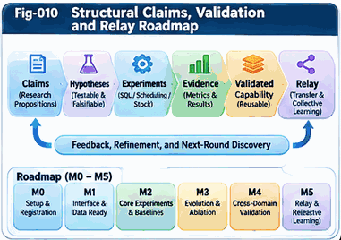

# VALIDATION ROADMAP

## Beyond Static Computation: Object-Centric Structural Evolution and Persistent Intelligence

**Status:** Research roadmap / proposed validation program  
**Version:** 1.0.0  
**Date:** 2026-11-08  
**Scope:** ASSI → D-BTP → CDE → WE-SIO → OCSRE, and their proposed integration with Residual-First, in-situ intelligence, persistent structural discovery, and Collective Learning Relay.

> **Research status.** The architectures and advantages described here are proposals, not established empirical results. Each claimed benefit requires reproducible evidence against appropriate baselines. Negative findings, unresolved residuals, and disagreements are first-class research outputs.

---



*Evidence governance links structural claims to falsifiable hypotheses, specifications, conformance tests, controlled experiments, reproducible evidence, and conditional capability promotion. Unverified, failed, or contradictory results return to the research registry instead of being silently promoted to validated capability. Relay packages preserve provenance, scope, and residual questions.*

---

## 1. Purpose

This roadmap converts the six synthesis papers, three interface specifications, and the open research agenda into a staged validation program. Its purpose is to distinguish: (i) representational feasibility; (ii) contract conformance; (iii) measurable engineering improvement; (iv) discovery of valid and transferable structures; and (v) improvement in the discovery process itself.

The roadmap prioritizes **specifications and conformance before runtime scale**. A minimal reference implementation is sufficient when it can falsify a claim. A large integrated platform is neither a prerequisite nor evidence of success.

## 2. Foundational source repositories

1. **ASSI — Adversarial Structural Security Intelligence:** https://github.com/sizhet/Adversarial-Structural-Security-Intelligence
2. **D-BTP — Dynamic Bucket Tree of Permutation:** https://github.com/sizhet/Dynamic-Bucket-Tree-of-Permutation-and-Directional-Structural-Evolution
3. **CDE — Constrained Delta Evolution:** https://github.com/sizhet/Constrained-Delta-Evolution
4. **WE-SIO — World Entity and Structural Intelligence Operations:** https://github.com/sizhet/World-Entity-and-Structural-Intelligence-Operations
5. **OCSRE — Object-Centric Structural Reasoning and Evolution:** https://github.com/sizhet/Object-Centric-Structural-Reasoning-and-Evolution

These repositories supply candidate structures and terminology; the present program tests the additional claims arising from their intersection. The synthesis is not a replacement for the underlying work.

## 3. Research principles and evidence rules

- **Separate observation, design, hypothesis, and validated result.** A specification can be conformant without proving a performance advantage.
- **Pre-register hypotheses, baselines, metrics, splits, and stopping rules** before evaluating held-out data.
- **Preserve object identity and provenance.** Every derived observation, residual, delta, candidate, validation outcome, and relay package must reference its source and version.
- **Measure total cost.** Include compute, storage, orchestration, latency, human review, integration, and operational risk.
- **Compare fairly.** Baselines receive comparable data, computational budgets, and engineering attention; tune on training/validation data only.
- **Report failures.** Unsuccessful deltas, invalid triggers, failed transfers, false discoveries, and security incidents remain in the evidence registry.
- **Keep action authority separate from discovery.** No discovered pattern, however promising, is automatically authorized for production action.
- **Preserve open disagreements.** Consult `RESEARCH-DIVERGENCES.md`; do not silently convert provisional positions into consensus.

## 4. Dependency map

```text
SPEC-001: Object / Residual / Delta semantics
             |
             v
Phase 0: Claim registry, datasets, measurement contracts
             |
             v
Phase 1: Interface and conformance validation
             |
             v
Phase 2: Single-domain incremental discovery experiments
             |
             v
Phase 3: CDE/OCSRE structural evolution and ablation
             |
             v
Phase 4: Persistent discovery and mechanism improvement
             |
             v
Phase 5: Cross-domain relay, governance, replication

SPEC-002: Persistent Discovery Loop -> Phases 2–4
SPEC-003: Validation and Relay -> Phases 0–5
ASSI adversarial and authority controls -> All phases
```

Stages may overlap after prerequisites are satisfied. Advancement is gated by evidence, not elapsed time or publication deadlines.

## 5. Phase 0 — Research baseline and pre-registration

**Objective:** Make every subsequent result interpretable.

**Tasks:**

1. Create `STRUCTURAL-CLAIMS-REGISTRY.md` entries linking each claim to the six papers, specifications, and `TESTABLE-HYPOTHESES.md` (TH-001–TH-018).
2. Select at least one public or releasable dataset for each proposed laboratory; document licensing, privacy, schema, units, time semantics, and expected data quality.
3. Freeze reference baselines and evaluation splits; define cost accounting, confidence intervals, and statistical testing rules.
4. Publish a versioned evaluation protocol, an experiment manifest, and a reproducibility checklist.
5. Define threat models for plugin execution, source manipulation, evidence laundering, and unauthorized action.

**Exit gate:** Every experiment has a named hypothesis, baseline, primary metric, falsification criterion, data lineage, and designated independent evaluation procedure.

**Deliverables:** Claim-to-test matrix, benchmark manifests, risk register, reproducibility protocol.

## 6. Phase 1 — WE-SIO and interface conformance

**Objective:** Establish that object-native representation and the Object–Residual–Delta interfaces are implementable without corrupting source semantics.

**Minimum experiments:**

- Map relational tables, rows, columns, primary/foreign keys, units, timestamps, and constraints into WE-SIO objects.
- Replay inserts, updates, deletes, late-arriving records, and schema changes from a deterministic CDC event log.
- Test object identity persistence, provenance, version conflict detection, residual-to-object references, and delta preconditions.
- Verify plugin capability discovery, permissions, idempotency, rollback/rejection, and failure isolation.
- Compare native SQL operations with object-layer execution for correctness and overhead.

**Baselines:** SQL-native queries and CDC pipelines; a conventional object/ORM layer; where relevant, a graph representation.

**Metrics:** Semantic mapping accuracy, query-result equivalence, replay determinism, stale-read rate, lineage completeness, memory overhead, throughput, p50/p95 latency, and engineering effort.

**Exit gate:** All mandatory `SPEC-001` conformance tests pass on the selected profile; mismatches and costs are explicitly reported. No claim of net superiority is inferred from passing conformance alone.

**Deliverables:** Mapping examples, machine-readable contracts, test fixtures, conformance report, performance profile.

## 7. Phase 2 — Residual-First and in-situ discovery

**Objective:** Test whether preserving structured residuals at their source improves subsequent analysis or action.

**Experiment A — SQL discovery laboratory:**

- Use a versioned multi-table dataset with injected and naturally occurring changes.
- Compare fixed business rules, SQL/stream anomaly detection, and a WE-SIO residual-aware discovery pipeline.
- Record candidate CCC, Two-Way CCC, and Pattern Trigger hypotheses with provenance and uncertainty.
- Test whether candidates survive independent datasets or held-out temporal windows.

**Ablations:** Remove residual history; remove cross-object relations; remove provenance; replace opportunity localization with uniform/random scanning.

**Metrics:** Precision/recall against labeled discoveries where available, false discovery rate, time to valid detection, verified discoveries per compute-hour, review workload, repeated-analysis savings, and cost per validated finding.

**Exit gate:** A reproducible discovery advantage on at least one pre-registered primary metric **without an unacceptable degradation** in false discovery rate, resource cost, or data integrity. If not met, report which subcomponents remain useful.

**Deliverables:** Discovery trace corpus, residual taxonomy examples, trigger audit log, ablation report.

## 8. Phase 3 — CDE/OCSRE structural evolution

**Objective:** Determine whether governed changes to state, candidate generation, and strategy produce measurable benefits beyond established dynamic methods.

**Experiment B — Dynamic school-bus scheduling:**

- Define a realistic constrained routing and assignment problem with time windows, capacity, ride-time limits, and vehicle availability.
- Compare fixed heuristics, local search, mixed-integer or constraint optimization where tractable, and conventional adaptive optimization.
- Evaluate CDE-generated deltas under the same feasible-set constraints and resource budget.
- Preserve path history, prevent invalid delta reuse, record loop-back controls, and verify termination or bounded stopping.
- Test controlled evolution of the candidate generator separately from changes to the solution state.

**Metrics:** Feasibility rate, vehicles required, total route cost, student ride time, response latency after perturbations, solver budget, and reproducibility.

**Critical ablations:** Fixed vs evolving generator; residual-aware vs residual-blind candidate prioritization; with vs without path memory; with vs without object-native state continuity.

**Exit gate:** Either demonstrate a pre-registered net benefit on constrained instances or establish the operating region in which standard methods outperform the proposed architecture. A result is invalid if constraints are relaxed asymmetrically.

**Deliverables:** Problem instances, solver adapters, delta traces, benchmark tables, negative cases.

## 9. Phase 4 — Persistent structural discovery and discovery-of-discovery

**Objective:** Test the strongest hypothesis: the system can improve its *future discovery process*, not merely accumulate more candidate patterns.

**Experiment design:**

1. Run the `SPEC-002` Observe → Align → Detect → Localize → Generate → Test → Validate → Act/Relay → Feedback loop over sequential data epochs.
2. Maintain a registry distinguishing Candidate, Replicated, Validated, Authorized, Deployed, Rejected, and Retired outcomes.
3. Allow governed modifications to pattern generators, trigger selection, or resource-allocation policies.
4. Keep a frozen evaluator and unseen future epochs to measure genuine improvement; prevent the evolving system from redefining success.
5. Compare with static discovery rules, incremental stream processing, and an online-learning/AutoML baseline.

**Primary metrics:** Held-out validated discoveries per unit total cost, time-to-validation, transfer success, false discovery rate, and longitudinal improvement in discovery efficiency.

**Key controls:** Multiple-testing correction; prequential/rolling-origin evaluation; leakage checks; concept-drift reporting; independent evaluator; frozen baseline snapshots; compute-budget parity.

**Exit gate:** Evidence of reproducible improvement on future held-out epochs, with uncertainty estimates and no hidden escalation in compute or human intervention. Otherwise characterize the observed system as persistent pattern discovery, not demonstrated emergent intelligence.

**Deliverables:** SEFL reference architecture, replayable discovery histories, discovery-efficiency learning curves, evaluator audit.

## 10. Phase 5 — Cross-domain relay and adversarial governance

**Objective:** Establish whether a validated local capability can be meaningfully transferred to another domain or research team.

**Transfer tasks:**

- Package a validated SQL discovery rule or residual-handling method as a Capability Relay Package (CRP).
- Attempt adaptation to a scheduling or time-series task, preserving semantic assumptions and known limitations.
- Compare transfer from full packages (contracts, evidence, provenance, negative cases) against code-only or description-only handoffs.
- Include independent reproduction by a second implementer where feasible.

**ASSI-informed security tests:** Malicious or inconsistent evidence, untrusted plugins, forged provenance, replay attacks, privilege escalation attempts, and mismatched authorization contexts.

**Metrics:** Transfer success rate, adaptation effort, reproduced effect size, semantic mismatch rate, evidence traceability, rejection of unsafe actions, and time to detect invalid relay packages.

**Exit gate:** At least one independently reproducible transfer with explicit local revalidation; security and authority checks pass the selected `SPEC-003` profile. A successful package transfer is not automatically evidence of generalized intelligence.

**Deliverables:** CRP examples, receiving-system conformance report, threat-model results, replication report, explicit leftover registry.

## 11. Financial time-series laboratory — later-stage stress test

**Experiment C — Stock Data** is deliberately deferred until the data lineage, leakage controls, and persistent discovery machinery are reliable.

Use point-in-time datasets with survivorship-bias controls, realistic transaction costs, slippage, and changing market regimes. Evaluate forecasts and decision policies out of sample using rolling windows; correct for multiple strategy searches. Compare to simple persistence, conventional factor models, and online-learning baselines.

**Metrics:** Calibration, predictive skill, risk-adjusted net performance, drawdown, turnover, stability across regimes, and full research/transaction cost. Prefer paper trading or simulation; live capital deployment is outside the initial research scope and requires separate authorization and risk governance.

A backtest improvement alone does not establish persistent comparative advantage or emergent intelligence.

## 12. Hypothesis-to-experiment traceability

The following grouping is a planning index; precise wording and falsification conditions remain authoritative in `TESTABLE-HYPOTHESES.md`.

| Hypothesis IDs | Main validation location | Principal evidence |
|---|---|---|
| TH-001–TH-003 | Phase 1 | Representation correctness, interoperability, overhead |
| TH-004–TH-006 | Phase 3 | Constrained evolution, generator adaptation, solver comparisons |
| TH-007–TH-010 | Phase 2 | Residual utility, in-situ continuity, localization ablations |
| TH-011–TH-014 | Phase 4 | Valid discovery, transferability, discovery-process improvement |
| TH-015–TH-017 | Phase 5 | Validation integrity, authority, relay reproducibility |
| TH-018 | Phases 3–5 | Full-system net benefit under matched total cost |

Every reported result must reference a hypothesis ID, experiment ID, dataset version, code/configuration version, evaluator version, and outcome status.

## 13. Evaluation and decision framework

### 13.1 Three independent scorecards

**Scientific validity:** Replication, uncertainty, falsification, held-out performance, evidence quality.

**Engineering value:** Correctness, latency, cost, maintainability, interoperability, security, deployment complexity.

**Collective Learning value:** Reproducibility, portability, clarity of contracts, useful negative findings, independent adoption.

Do not collapse these into a single opaque score. A system can be scientifically interesting but economically inefficient, or practically useful without proving the strongest theoretical hypothesis.

### 13.2 Advancement decisions

- **Advance:** Prerequisite contracts and pre-registered evidence gates pass.
- **Revise:** Partial benefits or semantic failures reveal a narrower, testable claim.
- **Hold:** Data quality, governance, or evaluator independence is insufficient.
- **Reject/Retire:** A claim is falsified or a method consistently underperforms suitable baselines.
- **Relay unfinished:** Preserve evidence and open questions regardless of the decision.

## 14. Minimum reproducibility package

For each experiment, publish where permissible:

```text
experiments/EXP-XXX/
  README.md
  hypothesis-and-preregistration.yaml
  dataset-manifest.yaml
  contracts-and-schema/
  baseline-configs/
  system-configs/
  test-fixtures/
  evaluation-protocol.md
  results-summary.md
  ablations.md
  failures-and-leftovers.md
  provenance-and-security.md
```

If source data cannot be released, provide synthetic fixtures, schema, generation procedure, and clear restrictions. Never publish private credentials or personal records.

### Example experiment manifest

```yaml
experiment_id: EXP-001
hypothesis_ids: [TH-001, TH-007]
phase: 2
status: proposed
system_variant: we_sio_residual_first
baselines:
  - sql_fixed_rules
  - stream_anomaly_detection
dataset:
  id: pending_selection
  version: pending
  temporal_split: preregister_before_execution
primary_metric: validated_discoveries_per_total_compute_hour
secondary_metrics:
  - false_discovery_rate
  - time_to_validation
  - total_operating_cost
independent_evaluation: required
negative_results_retained: true
action_authority: sandbox_only
```

## 15. Key failure modes and countermeasures

| Failure mode | Countermeasure |
|---|---|
| Residual explosion / noise amplification | Retention policy, deduplication, evidence ranking, compute budgets |
| False CCC or Pattern Trigger | Independent replication, temporal holdouts, multiple-testing control |
| Data or target leakage | Point-in-time joins, frozen splits, provenance audits |
| Evaluator gaming | External/frozen evaluation and separate authorization |
| CDE cycles or uncontrolled search | Path constraints, termination budgets, rollback, loop-back policy |
| SQL semantic mismatch | Unit/time/transaction contracts and differential testing |
| Plugin or relay compromise | Least privilege, signatures/provenance, sandbox, adversarial tests |
| Inflated spillover claims | Measure receiving-domain validation and adaptation costs |
| Cost hidden by integration | End-to-end resource and human-time accounting |
| Unresolved researcher disagreement | Explicit positions and discriminating tests in `RESEARCH-DIVERGENCES.md` |

## 16. Milestones and publication criteria

**M0 — Research-ready:** Claim registry, hypotheses, datasets, baselines, evaluator contracts.

**M1 — Conformant interfaces:** Reproducible WE-SIO/Object–Residual–Delta mapping and contract tests.

**M2 — Validated local discovery:** SQL/CDC discovery experiment and ablation evidence.

**M3 — Constrained evolution evidence:** Dynamic scheduling benchmarks with CDE/OCSRE comparisons.

**M4 — Persistent discovery evidence:** Longitudinal results distinguishing pattern accumulation from improvement in discovery capability.

**M5 — Transferable research output:** Independently revalidated relay package, negative findings, governance report.

**Publication principle:** The synthesis DOI may be published as a clearly labeled theoretical and specification-first research program before these milestones are complete. Experimental claims must be updated only when supporting evidence exists. Versions should record which claims remain untested, partially supported, contradicted, or independently replicated.

## 17. Open questions for roadmap revision

1. Which residual classes offer the highest value-to-cost ratio across domains?
2. How much semantic continuity must be retained for meaningful in-situ intelligence?
3. When does dynamic generator evolution outperform fixed, well-tuned search?
4. What evidence differentiates a new reusable capability from a rediscovered pattern?
5. How should opportunity-localization exploration budgets adapt under drift?
6. Can cross-domain relay preserve evidence without transferring unsafe assumptions?
7. What is the minimum independently reproducible demonstration of improved discovery ability?
8. When is object-native computation an advantage, and when is a conventional pipeline better?

## 18. Related repository documents

- `docs/001-Five-DOI-Peaks.md`
- `docs/002-WE-SIO-Object-Native-Intelligence.md`
- `docs/003-Structural-Evolution-Computing.md`
- `docs/004-Residual-First-In-Situ-Intelligence.md`
- `docs/005-Persistent-Structural-Discovery.md`
- `docs/006-Intelligence-Spillover-and-Relay.md`
- `specifications/SPEC-001-Object-Residual-Delta-Interfaces.md`
- `specifications/SPEC-002-Persistent-Discovery-Loop.md`
- `specifications/SPEC-003-Validation-and-Relay-Contracts.md`
- `research/RESEARCH-DIVERGENCES.md`
- `research/OPEN-QUESTIONS.md`
- `research/TESTABLE-HYPOTHESES.md`
- `research/STRUCTURAL-CLAIMS-REGISTRY.md`

Paths reflect the proposed repository structure; adapt relative links if the final directory layout differs.

## 19. Closing position

The central validation question is not whether the five DOI architectures can be combined in a diagram. It is whether their combination produces **reproducible, net-positive improvements in the discovery, validation, adaptation, and relay of useful structures**, under real constraints and against strong alternatives.

The program succeeds scientifically when it clarifies both the conditions of advantage and the conditions of failure. A well-documented negative result is a valid Relay to Collective Learning.

---

*Research roadmap — specification-first, evidence-led, and open to revision.*
